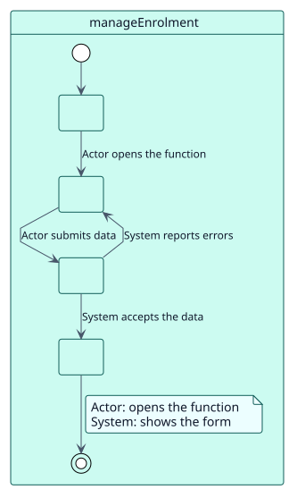

# UC-018 Manage an enrolment

| Overview | Requirements | Analysis | Design | Implementation | Tests |
| --- | --- | --- | --- | --- | --- |
| [Use cases](../../../01-requirements/use-case-overview.svg) | **Requirements** | [Analysis](../../../02-analysis/use-cases/manageEnrolment/README.md) | [Design](../../../03-design/use-cases/manageEnrolment/README.md) | [Implementation](../../../04-implementation/use-cases/manageEnrolment/README.md) | [Tests](../../../04-implementation/use-cases/manageEnrolment/README.md#tests) |

## Use-case information

| Field | Value |
| --- | --- |
| Actor | Teacher or manager (with `enrol.enrolment.manage`) |
| Package | enrolment |
| Goal | Suspend, reactivate, extend or remove a person's participation |
| Type | Primary, real |
| Level | User goal |
| Requirement | RF-041 |
| Domain entities | Enrolment, Enrolment status, Enrolment grant |

## Context

An enrolment has a status and a period. Suspension keeps everything; removal takes away the participation and its grants but never the person's records.

## Preconditions

- The actor holds `enrol.enrolment.manage` in the course; the enrolment is not derived from a linked source.

## Postconditions

- Success: the enrolment has its new status or period, or is removed with its grants; the event is published.
- Failure: no change.

## Main flow

| Step | Actor | System |
| --- | --- | --- |
| 1 | Opens a participant | Shows each enrolment with method, role, status and period |
| 2 | Suspends, reactivates or changes the period | Saves with If-Match; access changes at the next request (RN-060, RN-070) |
| 3 | Removes the enrolment | Removes it and its grants; keeps records and progress (RN-061, RN-069) |

## Alternative flows

| ID | Starts at step | Condition | Behaviour | Ends |
| --- | --- | --- | --- | --- |
| A1 | 3 | The enrolment comes from a system group or a course link | `conflict`: change the source instead (RN-067) | Failure |

## Business rules

| ID | Rule |
| --- | --- |
| RN-060 | Active participation |
| RN-061 | Owned grants |
| RN-069 | Records kept |
| RN-070 | Suspension |

## Specification

Behaviour source of truth: [specification.puml](./specification.puml)

## Wireframes

## Pending

| Question | Blocks |
| --- | --- |
| None | — |
