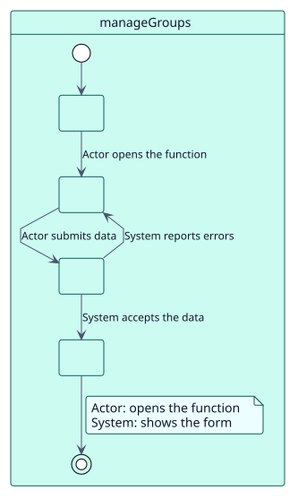
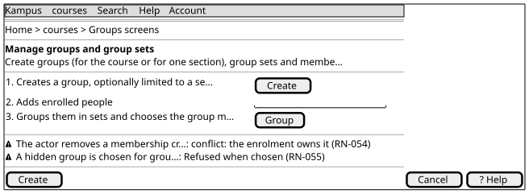

# UC-014 Manage groups and group sets

| Overview | Requirements | Analysis | Design | Implementation | Tests |
| --- | --- | --- | --- | --- | --- |
| [Use cases](../../../01-requirements/use-case-overview.svg) | **Requirements** | [Analysis](../../../02-analysis/use-cases/manageGroups/README.md) | [Design](../../../03-design/use-cases/manageGroups/README.md) | [Implementation](../../../04-implementation/use-cases/manageGroups/README.md) | [Tests](../../../04-implementation/use-cases/manageGroups/README.md#tests) |

## Use-case information

| Field | Value |
| --- | --- |
| Actor | Teacher or section leader (with `courses.groups.manage`) |
| Package | courses |
| Goal | Create groups (for the course or for one section), group sets and memberships, and choose the group mode |
| Type | Primary, real |
| Level | User goal |
| Requirement | RF-033 |
| Domain entities | Group, Group membership, Group set, Group mode |

## Context

Groups split participants. A section can have its own groups and its own group mode, so one part of a course can work in teams while the rest does not.

## Preconditions

- The actor holds `courses.groups.manage` in the course or the section.

## Postconditions

- Success: groups, sets and memberships are saved; events are published.
- Failure: no change.

## Main flow

| Step | Actor | System |
| --- | --- | --- |
| 1 | Creates a group, optionally limited to a section | Checks the name and code are unique in the course (RN-041) |
| 2 | Adds enrolled people | Refuses people who are not enrolled or cannot reach the section (RN-053) |
| 3 | Groups them in sets and chooses the group mode of the course, a section or an activity | Stores the mode as a setting of that scope (RN-057) |

## Alternative flows

| ID | Starts at step | Condition | Behaviour | Ends |
| --- | --- | --- | --- | --- |
| A1 | 2 | The actor removes a membership created by enrolment | `conflict`: the enrolment owns it (RN-054) | Failure |
| A2 | 3 | A hidden group is chosen for group mode | Refused when chosen (RN-055) | Failure |

## Business rules

| ID | Rule |
| --- | --- |
| RN-059 | Joining keys hashed |
| RN-041 | Unique group names |
| RN-053 | Members must be enrolled |
| RN-054 | Owned memberships |
| RN-055 | Hidden groups and group mode |
| RN-056 | Separate groups |
| RN-057 | Group mode by scope |
| RN-058 | Group sets |

## Specification

Behaviour source of truth: [specification.puml](./specification.puml)

## Wireframes

## Pending

| Question | Blocks |
| --- | --- |
| None | — |
