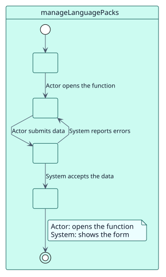

# UC-046 Install language packs and customise messages

| Overview | Requirements | Analysis | Design | Implementation | Tests |
| --- | --- | --- | --- | --- | --- |
| [Use cases](../../../01-requirements/use-case-overview.svg) | **Requirements** | [Analysis](../../../02-analysis/use-cases/manageLanguagePacks/README.md) | [Design](../../../03-design/use-cases/manageLanguagePacks/README.md) | [Implementation](../../../04-implementation/use-cases/manageLanguagePacks/README.md) | [Tests](../../../04-implementation/use-cases/manageLanguagePacks/README.md#tests) |

## Use-case information

| Field | Value |
| --- | --- |
| Actor | Campus administrator (with `i18n.manage`) |
| Package | i18n |
| Goal | Offer a language and adjust its wording for the campus or a scope |
| Type | Primary, real |
| Level | User goal |
| Requirement | RF-091 |
| Domain entities | Language pack, Translation, Customised message |

## Context

Packs are versioned per module; customised messages are kept apart, so updates never overwrite them.

## Preconditions

- The actor holds `i18n.manage`.

## Postconditions

- Success: the pack is installed or the message customised; caches of the bundles are invalidated.
- Failure: no change.

## Main flow

| Step | Actor | System |
| --- | --- | --- |
| 1 | Installs or updates a pack | Queues a job that loads the translations and reports removed messages (RN-193) |
| 2 | Customises a message for a scope | Checks placeholders (RN-188) and stores the customisation |
| 3 | Reviews missing translations | Lists them by how often they were needed (RN-190) |

## Alternative flows

| ID | Starts at step | Condition | Behaviour | Ends |
| --- | --- | --- | --- | --- |
| A1 | 2 | The placeholders differ from the source | `422` with the expected placeholders | Failure |

## Business rules

| ID | Rule |
| --- | --- |
| RN-187 | No literal strings |
| RN-188 | ICU messages |
| RN-190 | Missing strings |
| RN-193 | Packs never overwrite customisations |
| RN-194 | Content is not translated by packs |

## Specification

Behaviour source of truth: [specification.puml](./specification.puml)

## Wireframes

## Pending

| Question | Blocks |
| --- | --- |
| None | — |
