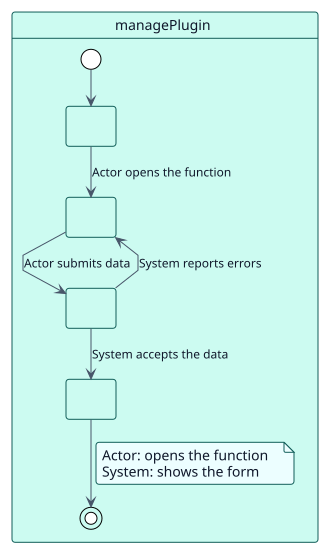

# UC-050 Upgrade, disable or remove a plugin

| Overview | Requirements | Analysis | Design | Implementation | Tests |
| --- | --- | --- | --- | --- | --- |
| [Use cases](../../../01-requirements/use-case-overview.svg) | **Requirements** | [Analysis](../../../02-analysis/use-cases/managePlugin/README.md) | [Design](../../../03-design/use-cases/managePlugin/README.md) | [Implementation](../../../04-implementation/use-cases/managePlugin/README.md) | [Tests](../../../04-implementation/use-cases/managePlugin/README.md#tests) |

## Use-case information

| Field | Value |
| --- | --- |
| Actor | Campus administrator (with `plugins.manage`) |
| Package | plugins |
| Goal | Keep extensions up to date, pause them or take them out without breaking the campus |
| Type | Primary, real |
| Level | User goal |
| Requirement | RF-100 |
| Domain entities | Installation, Plugin version, Plugin failure |

## Context

Disabling keeps data; removing runs the privacy handler; an upgrade with new capabilities waits for a grant while the old version runs.

## Preconditions

- The plugin is installed.

## Postconditions

- Success: the plugin is upgraded, disabled or removed, with its events published and an audit entry.
- Failure: the previous state is kept.

## Main flow

| Step | Actor | System |
| --- | --- | --- |
| 1 | Uploads a new version | Validates it as an install; asks for new capabilities if any (RN-205) |
| 2 | Disables the plugin | Stops its routes, listeners, jobs and UI modules at once; pauses deliveries (RN-209) |
| 3 | Removes it and confirms | Runs the privacy handler, deletes its schema and files; referencing content shows as unavailable (RN-210) |

## Alternative flows

| ID | Starts at step | Condition | Behaviour | Ends |
| --- | --- | --- | --- | --- |
| A1 | — | The plugin keeps failing | It is disabled automatically and administrators are alerted (RN-208) | Success |
| A2 | 1 | The upgrade migration fails | The previous version stays installed and enabled (RN-207) | Failure |

## Business rules

| ID | Rule |
| --- | --- |
| RN-205 | New capabilities wait |
| RN-207 | Migrations |
| RN-208 | Limits and automatic disabling |
| RN-209 | Disable keeps data |
| RN-210 | Removal |
| RN-211 | Compatible host interfaces |

## Specification

Behaviour source of truth: [specification.puml](./specification.puml)

## Wireframes

## Pending

| Question | Blocks |
| --- | --- |
| None | — |
