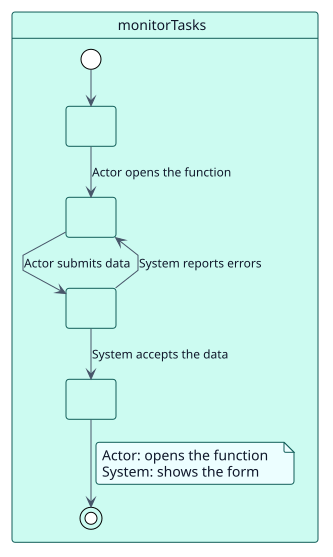

# UC-042 Monitor background tasks

| Overview | Requirements | Analysis | Design | Implementation | Tests |
| --- | --- | --- | --- | --- | --- |
| [Use cases](../../../01-requirements/use-case-overview.svg) | **Requirements** | [Analysis](../../../02-analysis/use-cases/monitorTasks/README.md) | [Design](../../../03-design/use-cases/monitorTasks/README.md) | [Implementation](../../../04-implementation/use-cases/monitorTasks/README.md) | [Tests](../../../04-implementation/use-cases/monitorTasks/README.md#tests) |

## Use-case information

| Field | Value |
| --- | --- |
| Actor | Campus administrator or operator (with `tasks.manage`) |
| Package | tasks |
| Goal | See what runs in the background, fix failures and adjust schedules |
| Type | Primary, real |
| Level | User goal |
| Requirement | RF-092 |
| Domain entities | Job, Job attempt, Schedule |

## Context

Every job and schedule has a visible state; failures alert and can be retried after the cause is fixed.

## Preconditions

- The actor holds `tasks.manage`.

## Postconditions

- Success: the chosen jobs are retried or cancelled, or the schedule is changed or run, and the change is recorded.
- Failure: nothing changes.

## Main flow

| Step | Actor | System |
| --- | --- | --- |
| 1 | Opens the task monitor | Lists jobs by state with attempts, progress and errors (RN-172) |
| 2 | Retries or cancels a job | Queues it again, or stops it at its next step (RN-176) |
| 3 | Changes or runs a schedule | Saves the rule and time zone, or enqueues a run now (RN-175) |

## Alternative flows

| ID | Starts at step | Condition | Behaviour | Ends |
| --- | --- | --- | --- | --- |
| A1 | 2 | A job of the same concurrency key is running | The retried job waits (RN-173) | Success |
| A2 | — | A worker dies while running | The lease expires and the job runs again (RN-171) | Success |

## Business rules

| ID | Rule |
| --- | --- |
| RN-170 | Transactional enqueue |
| RN-171 | Leases |
| RN-172 | Retries and failed state |
| RN-173 | Concurrency keys |
| RN-174 | Unique ticks |
| RN-175 | Configurable schedules |
| RN-176 | Progress and cancellation |

## Specification

Behaviour source of truth: [specification.puml](./specification.puml)

## Wireframes

## Pending

| Question | Blocks |
| --- | --- |
| None | — |
