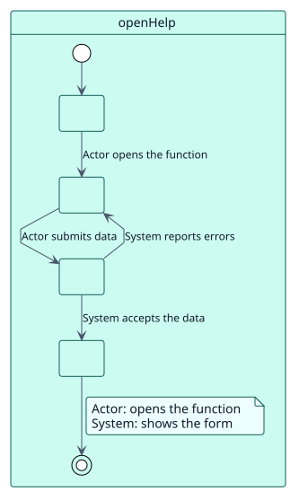
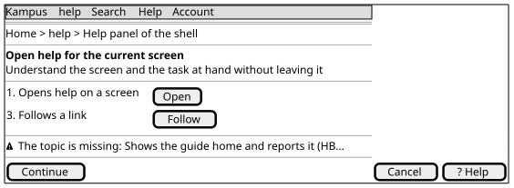

# UC-059 Open help for the current screen

| Overview | Requirements | Analysis | Design | Implementation | Tests |
| --- | --- | --- | --- | --- | --- |
| [Use cases](../../../01-requirements/use-case-overview.svg) | **Requirements** | [Analysis](../../../02-analysis/use-cases/openHelp/README.md) | [Design](../../../03-design/use-cases/openHelp/README.md) | [Implementation](../../../04-implementation/use-cases/openHelp/README.md) | [Tests](../../../04-implementation/use-cases/openHelp/README.md#tests) |

## Use-case information

| Field | Value |
| --- | --- |
| Actor | Any person, signed in or not |
| Package | help |
| Goal | Understand the screen and the task at hand without leaving it |
| Type | Primary, real |
| Level | User goal |
| Requirement | RF-009 |
| Domain entities | Help topic |

## Context

Every route and contribution declares a help topic; the handbook of the release provides it in the viewer's language, with the campus's terms.

## Preconditions

- The screen's UI module declares its help topic (UI-04).

## Postconditions

- Success: the help panel shows the topic for the viewer's role, with links to the full guide.
- Failure: the panel shows the guide's home and the missing topic is reported.

## Main flow

| Step | Actor | System |
| --- | --- | --- |
| 1 | Opens help on a screen | Resolves the topic of the route or contribution (HB-01) |
| 2 | — | Shows the text for the viewer's role and version, with terms applied and the campus's local pages (HB-02, HB-04) |
| 3 | Follows a link | Opens the full guide in the handbook |

## Alternative flows

| ID | Starts at step | Condition | Behaviour | Ends |
| --- | --- | --- | --- | --- |
| A1 | 1 | The topic is missing | Shows the guide home and reports it (HB-03) | Failure |

## Business rules

| ID | Rule |
| --- | --- |
| HB-01 | Declared topics |
| HB-02 | Role, version and terms |
| HB-03 | Missing topics fail the check |
| HB-04 | Local pages |

## Specification

Behaviour source of truth: [specification.puml](./specification.puml)

## Wireframes

## Pending

| Question | Blocks |
| --- | --- |
| None | — |
