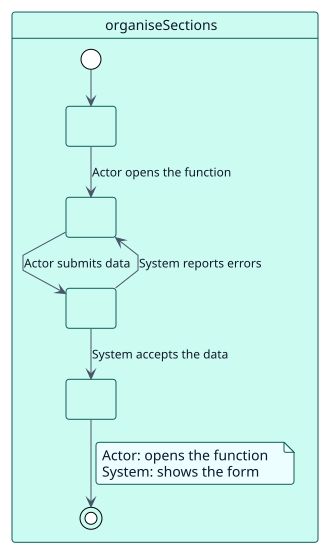

# UC-013 Organise the sections of a course

| Overview | Requirements | Analysis | Design | Implementation | Tests |
| --- | --- | --- | --- | --- | --- |
| [Use cases](../../../01-requirements/use-case-overview.svg) | **Requirements** | [Analysis](../../../02-analysis/use-cases/organiseSections/README.md) | [Design](../../../03-design/use-cases/organiseSections/README.md) | [Implementation](../../../04-implementation/use-cases/organiseSections/README.md) | [Tests](../../../04-implementation/use-cases/organiseSections/README.md#tests) |

## Use-case information

| Field | Value |
| --- | --- |
| Actor | Teacher or section leader (with `courses.section.manage` in the course or the section) |
| Package | courses |
| Goal | Add, nest, move, reorder, hide, schedule and delete sections without breaking links or permissions |
| Type | Primary, real |
| Level | User goal |
| Requirement | RF-032 |
| Domain entities | Section, Visibility, Scope |

## Context

Sections are scopes with stable identities. Links, highlights, permissions and groups attached to a section follow it wherever it moves.

## Preconditions

- The actor holds `courses.section.manage` in the course, or in the section for a section leader.

## Postconditions

- Success: the section tree reflects the change; one event is published.
- Failure: no change.

## Main flow

| Step | Actor | System |
| --- | --- | --- |
| 1 | Adds a section between two others, or inside another section | Creates it with its scope and a sort key between its neighbours |
| 2 | Drags a section to another place | Writes only its parent and sort key; moves its subtree in the scope closure (RN-045, RN-047) |
| 3 | Hides or schedules a section | Writes only its own visibility (RN-043) |

## Alternative flows

| ID | Starts at step | Condition | Behaviour | Ends |
| --- | --- | --- | --- | --- |
| A1 | 3 | The actor deletes a section with content | Asks to move the content or delete it; a job does it and the section goes to the recycle bin (RN-048) | Success |
| A2 | 2 | Two people reorder at the same time | The second gets `precondition_failed` and sees the new order (DEC-026) | Failure |

## Business rules

| ID | Rule |
| --- | --- |
| RN-044 | Hidden content for those allowed |
| RN-043 | Visibility never copied down |
| RN-045 | Stable ids and sort keys |
| RN-047 | Moving a subtree |
| RN-048 | Deleting sections with content |

## Specification

Behaviour source of truth: [specification.puml](./specification.puml)

## Wireframes

## Pending

| Question | Blocks |
| --- | --- |
| None | — |
