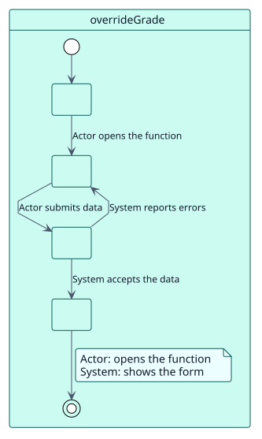

# UC-028 Override or lock a grade

| Overview | Requirements | Analysis | Design | Implementation | Tests |
| --- | --- | --- | --- | --- | --- |
| [Use cases](../../../01-requirements/use-case-overview.svg) | **Requirements** | [Analysis](../../../02-analysis/use-cases/overrideGrade/README.md) | [Design](../../../03-design/use-cases/overrideGrade/README.md) | [Implementation](../../../04-implementation/use-cases/overrideGrade/README.md) | [Tests](../../../04-implementation/use-cases/overrideGrade/README.md#tests) |

## Use-case information

| Field | Value |
| --- | --- |
| Actor | Teacher (with `records.override` or `records.lock`) |
| Package | records |
| Goal | Set a grade by hand, or freeze grades, with history |
| Type | Primary, real |
| Level | User goal |
| Requirement | RF-061 |
| Domain entities | Grade, Grade entry |

## Context

An override is an entry with the teacher as source; it wins until removed. Locks stop all changes.

## Preconditions

- The actor holds the permission.

## Postconditions

- Success: the grade is overridden or locked; an entry and events are recorded; totals are recalculated.
- Failure: no change.

## Main flow

| Step | Actor | System |
| --- | --- | --- |
| 1 | Sets a value and feedback in the grader report | Writes an entry with source `teacher` (RN-098) |
| 2 | Locks the record or the grade | Later activity grades are refused while locked |

## Alternative flows

| ID | Starts at step | Condition | Behaviour | Ends |
| --- | --- | --- | --- | --- |

## Business rules

| ID | Rule |
| --- | --- |
| RN-097 | Entries |
| RN-098 | Overrides and locks |

## Specification

Behaviour source of truth: [specification.puml](./specification.puml)

## Wireframes

## Pending

| Question | Blocks |
| --- | --- |
| None | — |
