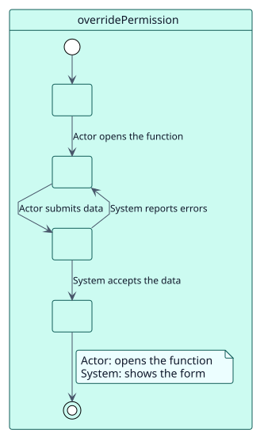

# UC-002 Override permissions in a scope

| Overview | Requirements | Analysis | Design | Implementation | Tests |
| --- | --- | --- | --- | --- | --- |
| [Use cases](../../../01-requirements/use-case-overview.svg) | **Requirements** | [Analysis](../../../02-analysis/use-cases/overridePermission/README.md) | [Design](../../../03-design/use-cases/overridePermission/README.md) | [Implementation](../../../04-implementation/use-cases/overridePermission/README.md) | [Tests](../../../04-implementation/use-cases/overridePermission/README.md#tests) |

## Use-case information

| Field | Value |
| --- | --- |
| Actor | Manager, Teacher, Section leader (with `access.override.update` and an allowance to override the role) |
| Package | access |
| Goal | Change what a role may do in one scope and its descendants, for example in one section only |
| Type | Primary, real |
| Level | User goal |
| Requirement | RF-024 |
| Domain entities | Permission override, Role, Permission, Scope |

## Context

Overrides adapt a role to a place: assistants who may grade only in their section, learners who may not post in one forum. Section scopes make this possible at section level (RF-024).

## Preconditions

- The actor holds `access.override.update` and may override the role (RN-014).
- Permissions with risks also need `access.override.risky`.

## Postconditions

- Success: the overrides of the role in the scope are set or cleared; `access.override_changed` is published and the scope subtree cache is refreshed.
- Failure: no change.

## Main flow

| Step | Actor | System |
| --- | --- | --- |
| 1 | Opens the permissions of a role in a scope | Shows each permission with its effective value and where it comes from (RN-019) |
| 2 | Sets values to allow, deny, forbid or inherit | Refuses permissions whose lowest kind is above this scope (RN-012) |
| 3 | Saves | Upserts or deletes the overrides with the version of the screen (If-Match), records the changes (RN-015) |

## Alternative flows

| ID | Starts at step | Condition | Behaviour | Ends |
| --- | --- | --- | --- | --- |
| A1 | 3 | Another person changed them meanwhile | `precondition_failed`; the screen reloads the current values (DEC-026) | Failure |
| A2 | 3 | The change would leave the campus without anyone able to manage access | Refused (RN-008) | Failure |

## Business rules

| ID | Rule |
| --- | --- |
| RN-004 | First value bottom-up wins |
| RN-005 | Forbid cannot be allowed again |
| RN-012 | Lowest scope kind |
| RN-014 | Permission and allowance to override |
| RN-015 | Inherit deletes; changes recorded |

## Specification

Behaviour source of truth: [specification.puml](./specification.puml)

## Wireframes

## Pending

| Question | Blocks |
| --- | --- |
| None | — |
