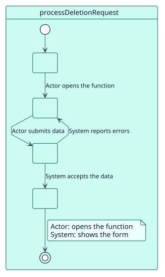

# UC-044 Process a deletion request

| Overview | Requirements | Analysis | Design | Implementation | Tests |
| --- | --- | --- | --- | --- | --- |
| [Use cases](../../../01-requirements/use-case-overview.svg) | **Requirements** | [Analysis](../../../02-analysis/use-cases/processDeletionRequest/README.md) | [Design](../../../03-design/use-cases/processDeletionRequest/README.md) | [Implementation](../../../04-implementation/use-cases/processDeletionRequest/README.md) | [Tests](../../../04-implementation/use-cases/processDeletionRequest/README.md#tests) |

## Use-case information

| Field | Value |
| --- | --- |
| Actor | Privacy officer (with `privacy.request.approve`) |
| Package | privacy |
| Goal | Erase a person's personal data, keeping what the law or the records require |
| Type | Primary, real |
| Level | User goal |
| Requirement | RF-093 |
| Domain entities | Data request, Request item, Legal hold |

## Context

Deletion produces the tombstone of RN-034; legal holds suspend it; every module erases its own data.

## Preconditions

- A deletion request exists; the actor holds `privacy.request.approve`.

## Postconditions

- Success: personal data is erased, the account is a tombstone and `privacy.account_erased` is published.
- Failure: the request is rejected with a reason, or waits on a hold.

## Main flow

| Step | Actor | System |
| --- | --- | --- |
| 1 | Reviews the request | Shows the data categories per module and any legal hold (RN-182) |
| 2 | Approves | Records the approval (RN-180) and starts one job per module |
| 3 | — | Each handler erases its data; identity turns the account into a tombstone (RN-181) |

## Alternative flows

| ID | Starts at step | Condition | Behaviour | Ends |
| --- | --- | --- | --- | --- |
| A1 | 2 | A legal hold applies | The request is held and says why | Failure |
| A2 | 2 | The officer rejects it | The person is told the reason | Failure |
| A3 | — | Retention ends for a category | A retention job erases it and records it (RN-184) | Success |

## Business rules

| ID | Rule |
| --- | --- |
| RN-180 | Approval |
| RN-181 | Tombstone |
| RN-182 | Legal holds |
| RN-184 | Retention by category |
| RN-185 | Policies and acceptances |

## Specification

Behaviour source of truth: [specification.puml](./specification.puml)

## Wireframes

## Pending

| Question | Blocks |
| --- | --- |
| None | — |
