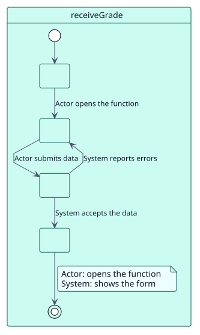

# UC-026 Receive a grade from an activity

| Overview | Requirements | Analysis | Design | Implementation | Tests |
| --- | --- | --- | --- | --- | --- |
| [Use cases](../../../01-requirements/use-case-overview.svg) | **Requirements** | [Analysis](../../../02-analysis/use-cases/receiveGrade/README.md) | [Design](../../../03-design/use-cases/receiveGrade/README.md) | [Implementation](../../../04-implementation/use-cases/receiveGrade/README.md) | [Tests](../../../04-implementation/use-cases/receiveGrade/README.md#tests) |

## Use-case information

| Field | Value |
| --- | --- |
| Actor | System (an activity type grading a person) |
| Package | records |
| Goal | Store a grade and update the totals that depend on it |
| Type | Primary, real |
| Level | User goal |
| Requirement | RF-061 |
| Domain entities | Grade record, Grade entry, Grade |

## Context

Activities send grades through one idempotent operation; totals are derived by a job, never by the reader.

## Preconditions

- The record exists and is not locked; the grade is not overridden or locked.

## Postconditions

- Success: an entry and the current grade are stored; `records.grade_changed` is published once; a recalculation job is queued.
- Failure: no change; the reason is returned (locked, overridden).

## Main flow

| Step | Actor | System |
| --- | --- | --- |
| 1 | An activity sends a grade for a person | Upserts on (record, person) (RN-096) and writes an entry (RN-097) |
| 2 | — | Queues the recalculation of the affected totals (RN-099) |

## Alternative flows

| ID | Starts at step | Condition | Behaviour | Ends |
| --- | --- | --- | --- | --- |
| A1 | 1 | The same grade is sent again | Nothing changes; no second event | Success |

## Business rules

| ID | Rule |
| --- | --- |
| RN-096 | Idempotent upserts |
| RN-097 | Entries |
| RN-098 | Overrides and locks win |
| RN-099 | Derived totals by a job |

## Specification

Behaviour source of truth: [specification.puml](./specification.puml)

## Wireframes

## Pending

| Question | Blocks |
| --- | --- |
| None | — |
