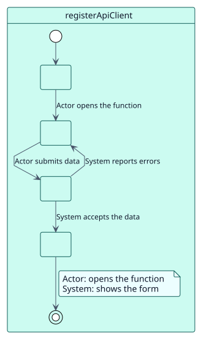

# UC-047 Register an API client

| Overview | Requirements | Analysis | Design | Implementation | Tests |
| --- | --- | --- | --- | --- | --- |
| [Use cases](../../../01-requirements/use-case-overview.svg) | **Requirements** | [Analysis](../../../02-analysis/use-cases/registerApiClient/README.md) | [Design](../../../03-design/use-cases/registerApiClient/README.md) | [Implementation](../../../04-implementation/use-cases/registerApiClient/README.md) | [Tests](../../../04-implementation/use-cases/registerApiClient/README.md#tests) |

## Use-case information

| Field | Value |
| --- | --- |
| Actor | Campus administrator or integrator (with `api.clients.manage`) |
| Package | api |
| Goal | Let an external system or application use the API with the least privilege it needs |
| Type | Primary, real |
| Level | User goal |
| Requirement | RF-103 |
| Domain entities | API client, API scope, Authorisation |

## Context

Service clients act as their service account; OAuth applications act for the people who authorise them; scopes never exceed permissions.

## Preconditions

- The actor holds `api.clients.manage`.

## Postconditions

- Success: the client exists and its secret was shown once; tokens can be issued within its scopes.
- Failure: nothing is registered.

## Main flow

| Step | Actor | System |
| --- | --- | --- |
| 1 | Registers a client with its kind and allowed scopes | Stores it, hashes the secret and shows it once |
| 2 | The system obtains a token | Issues it with its scopes; each call checks scope and permission (RN-196) |
| 3 | A person authorises an application | Runs authorisation code with PKCE and records the consent (RN-197) |

## Alternative flows

| ID | Starts at step | Condition | Behaviour | Ends |
| --- | --- | --- | --- | --- |
| A1 | 2 | Too many requests | `429` with `Retry-After` (RN-198) | Failure |
| A2 | 3 | A used refresh token is presented again | The whole token family is revoked (RN-197) | Failure |
| A3 | — | A route is deprecated | Answers with `Deprecation` and `Sunset` (RN-202) | Success |

## Business rules

| ID | Rule |
| --- | --- |
| RN-195 | Declared routes |
| RN-196 | Scopes within permissions |
| RN-197 | OAuth 2 with PKCE |
| RN-198 | Rate limits |
| RN-202 | Versions and deprecation |

## Specification

Behaviour source of truth: [specification.puml](./specification.puml)

## Wireframes

## Pending

| Question | Blocks |
| --- | --- |
| None | — |
