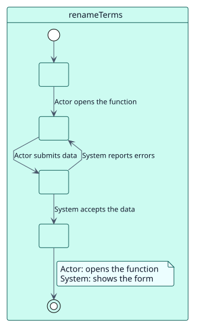
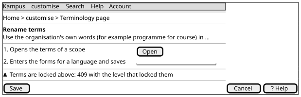

# UC-052 Rename terms

| Overview | Requirements | Analysis | Design | Implementation | Tests |
| --- | --- | --- | --- | --- | --- |
| [Use cases](../../../01-requirements/use-case-overview.svg) | **Requirements** | [Analysis](../../../02-analysis/use-cases/renameTerms/README.md) | [Design](../../../03-design/use-cases/renameTerms/README.md) | [Implementation](../../../04-implementation/use-cases/renameTerms/README.md) | [Tests](../../../04-implementation/use-cases/renameTerms/README.md#tests) |

## Use-case information

| Field | Value |
| --- | --- |
| Actor | Anyone holding `customise.terms.manage` in the scope |
| Package | customise |
| Goal | Use the organisation's own words (for example "programme" for course) in every language |
| Type | Primary, real |
| Level | User goal |
| Requirement | RF-006 |
| Domain entities | Term, Term override |

## Context

Messages refer to terms by code, so one rename is right in every sentence and grammatical form.

## Preconditions

- The actor holds `customise.terms.manage` in the scope.

## Postconditions

- Success: the scope and those below use the new word; `customise.changed` is published.
- Failure: no change.

## Main flow

| Step | Actor | System |
| --- | --- | --- |
| 1 | Opens the terms of a scope | Shows each term with its forms and origin (RN-213) |
| 2 | Enters the forms for a language and saves | Validates the forms the language needs and stores the override (RN-212) |

## Alternative flows

| ID | Starts at step | Condition | Behaviour | Ends |
| --- | --- | --- | --- | --- |
| A1 | 2 | Terms are locked above | `409` with the level that locked them | Failure |

## Business rules

| ID | Rule |
| --- | --- |
| RN-212 | Terms with forms |
| RN-213 | Resolution with origin |
| RN-222 | History and invalidation |

## Specification

Behaviour source of truth: [specification.puml](./specification.puml)

## Wireframes

## Pending

| Question | Blocks |
| --- | --- |
| None | — |
