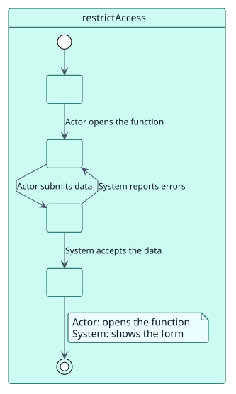

# UC-022 Restrict access to an activity or section

| Overview | Requirements | Analysis | Design | Implementation | Tests |
| --- | --- | --- | --- | --- | --- |
| [Use cases](../../../01-requirements/use-case-overview.svg) | **Requirements** | [Analysis](../../../02-analysis/use-cases/restrictAccess/README.md) | [Design](../../../03-design/use-cases/restrictAccess/README.md) | [Implementation](../../../04-implementation/use-cases/restrictAccess/README.md) | [Tests](../../../04-implementation/use-cases/restrictAccess/README.md#tests) |

## Use-case information

| Field | Value |
| --- | --- |
| Actor | Teacher (with `activities.conditions.manage`) |
| Package | activities |
| Goal | Open an activity or a section only when dates, grades, progress, groups or profile fields allow it |
| Type | Primary, real |
| Level | User goal |
| Requirement | RF-051 |
| Domain entities | Access condition |

## Context

Conditions are typed rows that point to what they depend on, combined in a tree of all, any and not.

## Preconditions

- The actor holds `activities.conditions.manage`.

## Postconditions

- Success: the condition tree is saved; `activities.conditions_changed` is published.
- Failure: no change.

## Main flow

| Step | Actor | System |
| --- | --- | --- |
| 1 | Builds a tree of conditions | Offers only targets the actor may see |
| 2 | Saves | Validates each condition and its foreign key; replaces the tree with If-Match |

## Alternative flows

| ID | Starts at step | Condition | Behaviour | Ends |
| --- | --- | --- | --- | --- |
| A1 | 2 | Someone later deletes what a condition depends on | The deletion is refused or rewrites the condition explicitly (RN-081) | Success |
| A2 | 1 | A condition type is disabled later | The module becomes unavailable and the teacher is told (RN-082) | Success |

## Business rules

| ID | Rule |
| --- | --- |
| RN-080 | Typed conditions |
| RN-081 | Dependencies protected |
| RN-082 | Unknown conditions close |
| RN-083 | Section conditions |

## Specification

Behaviour source of truth: [specification.puml](./specification.puml)

## Wireframes

## Pending

| Question | Blocks |
| --- | --- |
| None | — |
