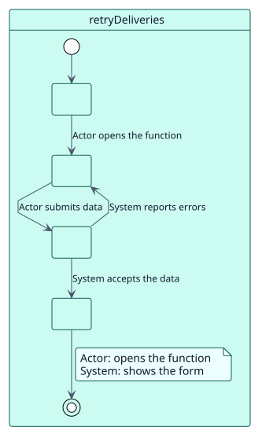

# UC-035 Review and retry failed event deliveries

| Overview | Requirements | Analysis | Design | Implementation | Tests |
| --- | --- | --- | --- | --- | --- |
| [Use cases](../../../01-requirements/use-case-overview.svg) | **Requirements** | [Analysis](../../../02-analysis/use-cases/retryDeliveries/README.md) | [Design](../../../03-design/use-cases/retryDeliveries/README.md) | [Implementation](../../../04-implementation/use-cases/retryDeliveries/README.md) | [Tests](../../../04-implementation/use-cases/retryDeliveries/README.md#tests) |

## Use-case information

| Field | Value |
| --- | --- |
| Actor | Campus administrator or operator (with `events.deliveries.manage`) |
| Package | events |
| Goal | See which listeners failed and retry them once the cause is fixed |
| Type | Primary, real |
| Level | User goal |
| Requirement | RF-081 |
| Domain entities | Delivery, Listener, Event |

## Context

Listeners receive each event at least once; after the last retry a delivery goes to the dead-letter list instead of being lost.

## Preconditions

- The actor holds `events.deliveries.manage`.

## Postconditions

- Success: the chosen deliveries are queued again.
- Failure: nothing changes.

## Main flow

| Step | Actor | System |
| --- | --- | --- |
| 1 | Opens the dead-letter list | Lists dead deliveries with the event, the listener and the last error (RN-139) |
| 2 | Retries one or many | Queues them again, in the object's order (RN-140) |

## Alternative flows

| ID | Starts at step | Condition | Behaviour | Ends |
| --- | --- | --- | --- | --- |
| A1 | 2 | The listener belongs to a disabled plugin | The delivery stays paused until the plugin is enabled (RN-142) | Success |

## Business rules

| ID | Rule |
| --- | --- |
| RN-137 | Declared events |
| RN-138 | Outbox after commit |
| RN-139 | At least once, dead letter |
| RN-140 | Order per object |
| RN-142 | Disabled listeners paused |

## Specification

Behaviour source of truth: [specification.puml](./specification.puml)

## Wireframes

## Pending

| Question | Blocks |
| --- | --- |
| None | — |
