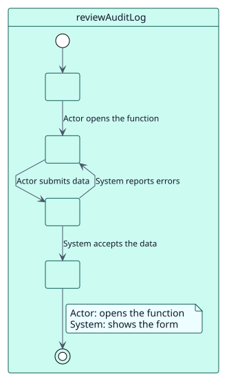

# UC-036 Review the audit log

| Overview | Requirements | Analysis | Design | Implementation | Tests |
| --- | --- | --- | --- | --- | --- |
| [Use cases](../../../01-requirements/use-case-overview.svg) | **Requirements** | [Analysis](../../../02-analysis/use-cases/reviewAuditLog/README.md) | [Design](../../../03-design/use-cases/reviewAuditLog/README.md) | [Implementation](../../../04-implementation/use-cases/reviewAuditLog/README.md) | [Tests](../../../04-implementation/use-cases/reviewAuditLog/README.md#tests) |

## Use-case information

| Field | Value |
| --- | --- |
| Actor | Teacher or manager (with `events.audit.view` in the scope) |
| Package | events |
| Goal | Find who did what, when and where, within what they may see |
| Type | Primary, real |
| Level | User goal |
| Requirement | RF-082 |
| Domain entities | Audit entry |

## Context

Audit entries are written in the change's transaction and never altered; reports read them with the objects' permissions.

## Preconditions

- The actor holds `events.audit.view` in the scope.

## Postconditions

- Success: the entries matching the filters, visible to the actor, are shown or exported.
- Failure: nothing is shown.

## Main flow

| Step | Actor | System |
| --- | --- | --- |
| 1 | Filters by scope, person, object and dates | Returns a page of entries visible to the actor (RN-144) |
| 2 | Exports the range | Queues an export job and notifies when ready |

## Alternative flows

| ID | Starts at step | Condition | Behaviour | Ends |
| --- | --- | --- | --- | --- |
| A1 | 1 | An entry is about an object the actor may not see | It is left out (RN-144) | Success |
| A2 | 1 | The person was erased | Shown by pseudonym (RN-145) | Success |

## Business rules

| ID | Rule |
| --- | --- |
| RN-143 | Append-only audit |
| RN-144 | Same permissions as the object |
| RN-145 | Personal data declared |
| RN-146 | Audit apart from operational logs |

## Specification

Behaviour source of truth: [specification.puml](./specification.puml)

## Wireframes

## Pending

| Question | Blocks |
| --- | --- |
| None | — |
