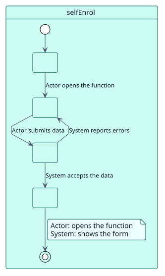

# UC-017 Enrol oneself in a course

| Overview | Requirements | Analysis | Design | Implementation | Tests |
| --- | --- | --- | --- | --- | --- |
| [Use cases](../../../01-requirements/use-case-overview.svg) | **Requirements** | [Analysis](../../../02-analysis/use-cases/selfEnrol/README.md) | [Design](../../../03-design/use-cases/selfEnrol/README.md) | [Implementation](../../../04-implementation/use-cases/selfEnrol/README.md) | [Tests](../../../04-implementation/use-cases/selfEnrol/README.md#tests) |

## Use-case information

| Field | Value |
| --- | --- |
| Actor | Any signed-in person with `enrol.self`, where the course offers self-enrolment |
| Package | enrolment |
| Goal | Join a course, with a key, an approval or a payment when the course asks for one |
| Type | Primary, real |
| Level | User goal |
| Requirement | RF-042 |
| Domain entities | Method instance, Self-enrolment key, Enrolment request, Enrolment |

## Context

Self-enrolment can be open, protected by a key (which may also place the person in a group), subject to approval, or gated by a payment through the payment port.

## Preconditions

- The instance is enabled and open now; the person meets its restrictions.

## Postconditions

- Success: an active enrolment, a pending request, or a pending payment; the matching event is published.
- Failure: no enrolment; the reason is given (full, closed, wrong key).

## Main flow

| Step | Actor | System |
| --- | --- | --- |
| 1 | Opens the course page and chooses to join | Shows what the instance requires |
| 2 | Gives the key if asked | Checks it in constant time, with throttling (RN-064) |
| 3 | Confirms | In one transaction with a lock on the instance: checks capacity and period, creates the enrolment, its grant and group membership (RN-063) |

## Alternative flows

| ID | Starts at step | Condition | Behaviour | Ends |
| --- | --- | --- | --- | --- |
| A1 | 3 | The instance requires approval | Creates a request; the person is told and notified when it is decided (RN-065) | Success |
| A2 | 3 | The instance requires a payment | Starts the payment; the enrolment is created when the payment is confirmed (RN-066) | Success |
| A3 | 3 | The instance is full or closed | `conflict` with the reason | Failure |

## Business rules

| ID | Rule |
| --- | --- |
| RN-072 | Guest access is not an enrolment |
| RN-063 | Limits in the transaction |
| RN-064 | Keys |
| RN-065 | Approval |
| RN-066 | Payment |

## Specification

Behaviour source of truth: [specification.puml](./specification.puml)

## Wireframes

## Pending

| Question | Blocks |
| --- | --- |
| None | — |
