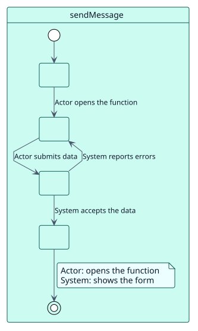

# UC-038 Send a message

| Overview | Requirements | Analysis | Design | Implementation | Tests |
| --- | --- | --- | --- | --- | --- |
| [Use cases](../../../01-requirements/use-case-overview.svg) | **Requirements** | [Analysis](../../../02-analysis/use-cases/sendMessage/README.md) | [Design](../../../03-design/use-cases/sendMessage/README.md) | [Implementation](../../../04-implementation/use-cases/sendMessage/README.md) | [Tests](../../../04-implementation/use-cases/sendMessage/README.md#tests) |

## Use-case information

| Field | Value |
| --- | --- |
| Actor | Any signed-in person the campus rules allow to write to the recipients |
| Package | notify |
| Goal | Talk with another person or a group |
| Type | Primary, real |
| Level | User goal |
| Requirement | RF-071 |
| Domain entities | Conversation, Member, Message |

## Context

A direct conversation is unique per pair; course groups have their own conversation; deletion is per member.

## Preconditions

- A campus rule allows the conversation and nobody has blocked the sender.

## Postconditions

- Success: the message is stored and notifications are queued for the other members.
- Failure: nothing is sent.

## Main flow

| Step | Actor | System |
| --- | --- | --- |
| 1 | Opens a conversation with a person or group | Finds or creates it under its unique key (RN-152) |
| 2 | Writes and sends | Checks rules and blocks (RN-153), sanitises the body (RN-155), stores it and queues notifications |

## Alternative flows

| ID | Starts at step | Condition | Behaviour | Ends |
| --- | --- | --- | --- | --- |
| A1 | 2 | Blocked or not allowed | `403` without telling who blocked | Failure |
| A2 | — | Every member deleted the message | A job purges it (RN-154) | Success |

## Business rules

| ID | Rule |
| --- | --- |
| RN-152 | Unique conversations |
| RN-153 | Who may write |
| RN-154 | Deletion and retention |
| RN-155 | Sanitised bodies |

## Specification

Behaviour source of truth: [specification.puml](./specification.puml)

## Wireframes

## Pending

| Question | Blocks |
| --- | --- |
| None | — |
