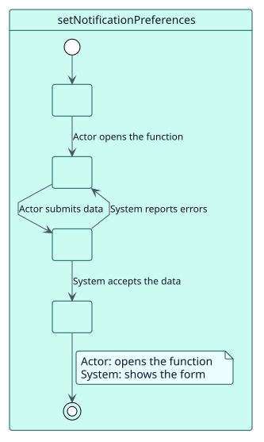

# UC-037 Choose how to be notified

| Overview | Requirements | Analysis | Design | Implementation | Tests |
| --- | --- | --- | --- | --- | --- |
| [Use cases](../../../01-requirements/use-case-overview.svg) | **Requirements** | [Analysis](../../../02-analysis/use-cases/setNotificationPreferences/README.md) | [Design](../../../03-design/use-cases/setNotificationPreferences/README.md) | [Implementation](../../../04-implementation/use-cases/setNotificationPreferences/README.md) | [Tests](../../../04-implementation/use-cases/setNotificationPreferences/README.md#tests) |

## Use-case information

| Field | Value |
| --- | --- |
| Actor | Any signed-in person |
| Package | notify |
| Goal | Choose the channels and digests for each kind of notification |
| Type | Primary, real |
| Level | User goal |
| Requirement | RF-070 |
| Domain entities | Notification type, Preference, Campus default |

## Context

Modules declare notification types; one resolver combines the person's preferences with the campus defaults and locks.

## Preconditions

- The person is signed in.

## Postconditions

- Success: the preferences are saved and every later delivery follows them.
- Failure: no change.

## Main flow

| Step | Actor | System |
| --- | --- | --- |
| 1 | Opens the preferences | Shows each type with its channels, the campus defaults and what is locked (RN-148) |
| 2 | Changes channels or digests and saves | Validates and replaces the rows with If-Match |

## Alternative flows

| ID | Starts at step | Condition | Behaviour | Ends |
| --- | --- | --- | --- | --- |
| A1 | 2 | A required type has every channel off | `422`: required types can only be routed (RN-147) | Failure |
| A2 | 2 | The campus locked a type | The locked row is kept (RN-148) | Success |

## Business rules

| ID | Rule |
| --- | --- |
| RN-147 | Declared and required types |
| RN-148 | Typed preferences |
| RN-149 | Delivery jobs |
| RN-150 | Templates |
| RN-151 | Inbox |

## Specification

Behaviour source of truth: [specification.puml](./specification.puml)

## Wireframes

## Pending

| Question | Blocks |
| --- | --- |
| None | — |
