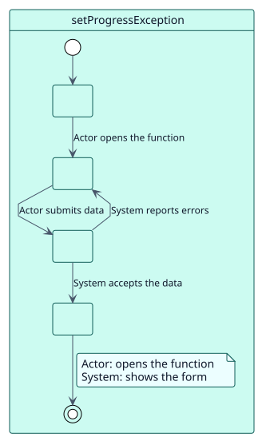

# UC-032 Set a progress exception

| Overview | Requirements | Analysis | Design | Implementation | Tests |
| --- | --- | --- | --- | --- | --- |
| [Use cases](../../../01-requirements/use-case-overview.svg) | **Requirements** | [Analysis](../../../02-analysis/use-cases/setProgressException/README.md) | [Design](../../../03-design/use-cases/setProgressException/README.md) | [Implementation](../../../04-implementation/use-cases/setProgressException/README.md) | [Tests](../../../04-implementation/use-cases/setProgressException/README.md#tests) |

## Use-case information

| Field | Value |
| --- | --- |
| Actor | Teacher (with `progress.exception`) |
| Package | progress |
| Goal | Decide a person's state on a course module, with a reason |
| Type | Primary, real |
| Level | User goal |
| Requirement | RF-063 |
| Domain entities | Progress exception |

## Context

Exceptions are decisions of people: recorded, visible, and never overwritten by recalculations.

## Preconditions

- The actor holds `progress.exception`.

## Postconditions

- Success: the state is set by the exception, with history and an event.
- Failure: no change.

## Main flow

| Step | Actor | System |
| --- | --- | --- |
| 1 | Chooses a person, a state and a reason | Stores the exception (RN-119) |
| 2 | Removes it later | The rules apply again |

## Alternative flows

| ID | Starts at step | Condition | Behaviour | Ends |
| --- | --- | --- | --- | --- |

## Business rules

| ID | Rule |
| --- | --- |
| RN-118 | People's records kept |
| RN-119 | Exceptions with reason and history |

## Specification

Behaviour source of truth: [specification.puml](./specification.puml)

## Wireframes

## Pending

| Question | Blocks |
| --- | --- |
| None | — |
