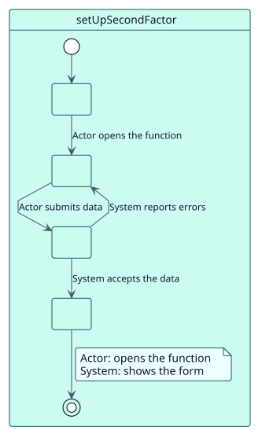

# UC-008 Set up a second factor

| Overview | Requirements | Analysis | Design | Implementation | Tests |
| --- | --- | --- | --- | --- | --- |
| [Use cases](../../../01-requirements/use-case-overview.svg) | **Requirements** | [Analysis](../../../02-analysis/use-cases/setUpSecondFactor/README.md) | [Design](../../../03-design/use-cases/setUpSecondFactor/README.md) | [Implementation](../../../04-implementation/use-cases/setUpSecondFactor/README.md) | [Tests](../../../04-implementation/use-cases/setUpSecondFactor/README.md#tests) |

## Use-case information

| Field | Value |
| --- | --- |
| Actor | Any signed-in person; administrators require it per campus or per role |
| Package | identity |
| Goal | Protect the account with a passkey, an authenticator app or email codes, and keep recovery codes |
| Type | Primary, real |
| Level | User goal |
| Requirement | RF-012 |
| Domain entities | Second factor, Passkey, Recovery code |

## Context

Second factors protect sign-in, sensitive operations (step-up) and recovery. Roles with risky permissions can require them where they are granted.

## Preconditions

- The person signed in recently with a strong method (step-up, RN-032).

## Postconditions

- Success: the factor is active and recovery codes were shown once; `identity.second_factor_added` is published and the account is notified.
- Failure: no change.

## Main flow

| Step | Actor | System |
| --- | --- | --- |
| 1 | Chooses passkey, authenticator app or email codes | Asks for step-up when the last strong authentication is too old |
| 2 | Registers the passkey or enters the first code | Verifies it |
| 3 | Saves the recovery codes | Stores only their hashes (RN-029) |

## Alternative flows

| ID | Starts at step | Condition | Behaviour | Ends |
| --- | --- | --- | --- | --- |
| A1 | 1 | The person removes a factor | Step-up; refused if a role or the campus requires a factor and it is the last one | Success or failure |

## Business rules

| ID | Rule |
| --- | --- |
| RN-029 | Second factors and recovery codes |
| RN-032 | Step-up for sensitive operations |

## Specification

Behaviour source of truth: [specification.puml](./specification.puml)

## Wireframes

## Pending

| Question | Blocks |
| --- | --- |
| None | — |
