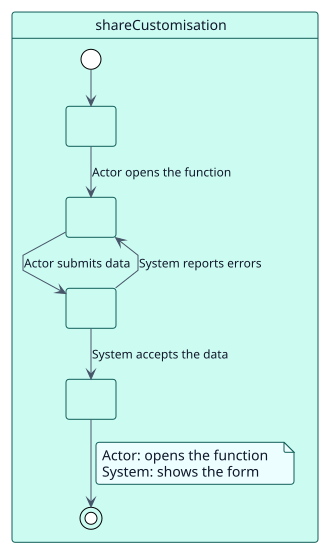

# UC-058 Export and import customisations

| Overview | Requirements | Analysis | Design | Implementation | Tests |
| --- | --- | --- | --- | --- | --- |
| [Use cases](../../../01-requirements/use-case-overview.svg) | **Requirements** | [Analysis](../../../02-analysis/use-cases/shareCustomisation/README.md) | [Design](../../../03-design/use-cases/shareCustomisation/README.md) | [Implementation](../../../04-implementation/use-cases/shareCustomisation/README.md) | [Tests](../../../04-implementation/use-cases/shareCustomisation/README.md#tests) |

## Use-case information

| Field | Value |
| --- | --- |
| Actor | Campus administrator (with `customise.packages.manage`) |
| Package | customise |
| Goal | Reuse a configuration in another campus or scope |
| Type | Primary, real |
| Level | User goal |
| Requirement | RF-004 |
| Domain entities | Customisation package |

## Context

Packages hold terms, fields, layouts, menus, themes, rules, flags, settings and templates; imports are previewed and applied in one transaction.

## Preconditions

- The actor holds `customise.packages.manage` in source and target.

## Postconditions

- Success: the target has the customisations of the package, recorded as one change.
- Failure: no change.

## Main flow

| Step | Actor | System |
| --- | --- | --- |
| 1 | Exports chosen kinds from a scope | Builds a versioned package with a checksum |
| 2 | Uploads it to the target and previews | Validates against the target's declarations and lists the differences (RN-221) |
| 3 | Applies | Applies everything in one transaction and records it |

## Alternative flows

| ID | Starts at step | Condition | Behaviour | Ends |
| --- | --- | --- | --- | --- |
| A1 | 2 | The package refers to a widget, field type or event not present | Those parts are listed as not applicable | Success |

## Business rules

| ID | Rule |
| --- | --- |
| RN-221 | Validated packages |
| RN-222 | History |

## Specification

Behaviour source of truth: [specification.puml](./specification.puml)

## Wireframes

## Pending

| Question | Blocks |
| --- | --- |
| None | — |
