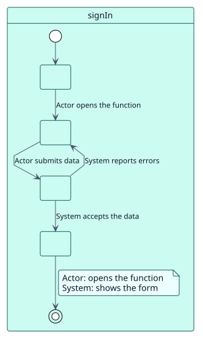

# UC-007 Sign in, or recover access

| Overview | Requirements | Analysis | Design | Implementation | Tests |
| --- | --- | --- | --- | --- | --- |
| [Use cases](../../../01-requirements/use-case-overview.svg) | **Requirements** | [Analysis](../../../02-analysis/use-cases/signIn/README.md) | [Design](../../../03-design/use-cases/signIn/README.md) | [Implementation](../../../04-implementation/use-cases/signIn/README.md) | [Tests](../../../04-implementation/use-cases/signIn/README.md#tests) |

## Use-case information

| Field | Value |
| --- | --- |
| Actor | Visitor with an account (password, passkey or an identity provider) |
| Package | identity |
| Goal | Start a session through one secure pipeline, whatever the method |
| Type | Primary, real |
| Level | User goal |
| Requirement | RF-011 |
| Domain entities | Account, Credential, External identity, Second factor, Session, Sign-in attempt |

## Context

Password, passkey and identity providers all go through the same steps (RN-024), so none of them can skip throttling, the account status or the second factor.

## Preconditions

- The campus is open for sign-in.

## Postconditions

- Success: a server-side session with its second-factor level; `identity.signed_in` is published.
- Failure: no session; the attempt is recorded for throttling.

## Main flow

| Step | Actor | System |
| --- | --- | --- |
| 1 | Chooses password, passkey or an identity provider | Identifies the account (for a provider: by issuer and subject, RN-028) |
| 2 | — | Checks the status (RN-023) and throttling (RN-027), then the credential |
| 3 | Gives the second factor when asked | Verifies it (RN-029) |
| 4 | — | Creates the session, records the attempt, publishes the event |

## Alternative flows

| ID | Starts at step | Condition | Behaviour | Ends |
| --- | --- | --- | --- | --- |
| A1 | 1 | The provider identity is not linked yet | Links only by policy (verified email) or after the owner confirms (RN-028) | Success or failure |
| A2 | 1 | The person forgot the password | Recovery: token by email, then second factor or recovery code, then the new password; sessions revoked; not signed in (RN-030) | Success |
| A3 | 2 | Too many attempts | Slows down, then locks temporarily; the answer does not reveal the account (RN-027) | Failure |

## Business rules

| ID | Rule |
| --- | --- |
| RN-024 | One sign-in pipeline |
| RN-027 | Throttling |
| RN-028 | Linking by issuer and subject |
| RN-029 | Second factor |
| RN-030 | Recovery checks the second factor |
| RN-031 | Server-side sessions |

## Specification

Behaviour source of truth: [specification.puml](./specification.puml)

## Wireframes

## Pending

| Question | Blocks |
| --- | --- |
| None | — |
