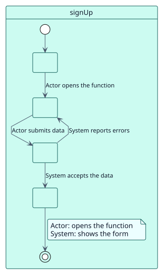
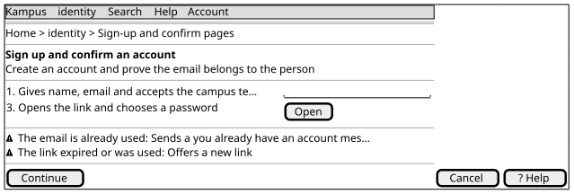

# UC-006 Sign up and confirm an account

| Overview | Requirements | Analysis | Design | Implementation | Tests |
| --- | --- | --- | --- | --- | --- |
| [Use cases](../../../01-requirements/use-case-overview.svg) | **Requirements** | [Analysis](../../../02-analysis/use-cases/signUp/README.md) | [Design](../../../03-design/use-cases/signUp/README.md) | [Implementation](../../../04-implementation/use-cases/signUp/README.md) | [Tests](../../../04-implementation/use-cases/signUp/README.md#tests) |

## Use-case information

| Field | Value |
| --- | --- |
| Actor | Visitor, when the campus allows self sign-up; invited people follow the same confirmation path |
| Package | identity |
| Goal | Create an account and prove the email belongs to the person |
| Type | Primary, real |
| Level | User goal |
| Requirement | RF-010 |
| Domain entities | Account, One-time token, Password, Profile |

## Context

Campuses decide whether people can sign up by themselves, and from which email domains. Invitations created by managers use the same confirmation and set-password step.

## Preconditions

- Self sign-up is enabled for the campus, or the person holds an invitation link.

## Postconditions

- Success: an active account with a password set by the person and a profile; `identity.account_confirmed` is published.
- Failure: no account, or an account still pending confirmation.

## Main flow

| Step | Actor | System |
| --- | --- | --- |
| 1 | Gives name, email and accepts the campus terms | Checks the domain policy; answers the same whether or not the email is taken (RN-027) |
| 2 | — | Creates the account as `pending_confirmation` and sends a one-time link (RN-026) |
| 3 | Opens the link and chooses a password | Verifies the token, applies the password policy (RN-025), activates the account (RN-023) |

## Alternative flows

| ID | Starts at step | Condition | Behaviour | Ends |
| --- | --- | --- | --- | --- |
| A1 | 1 | The email is already used | Sends a "you already have an account" message to that email instead; the visitor sees the same answer | Success |
| A2 | 3 | The link expired or was used | Offers a new link | Failure |

## Business rules

| ID | Rule |
| --- | --- |
| RN-022 | Unique username and email in the campus |
| RN-023 | Lifecycle transitions |
| RN-025 | Passwords chosen by the person, hashed with Argon2id |
| RN-026 | One-time tokens |
| RN-027 | No account enumeration |

## Specification

Behaviour source of truth: [specification.puml](./specification.puml)

## Wireframes

## Pending

| Question | Blocks |
| --- | --- |
| None | — |
