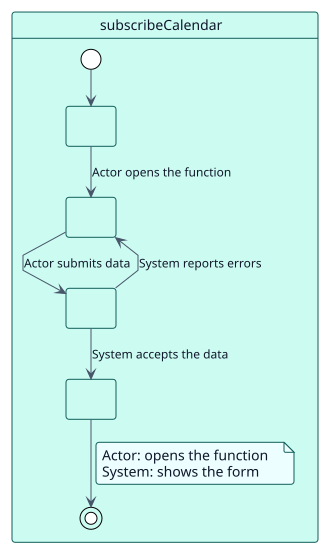
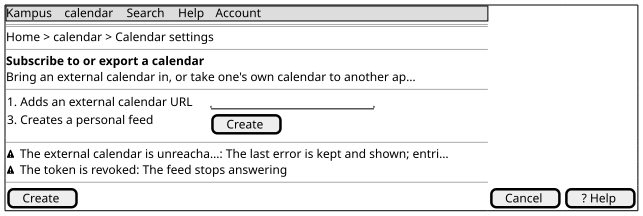

# UC-040 Subscribe to or export a calendar

| Overview | Requirements | Analysis | Design | Implementation | Tests |
| --- | --- | --- | --- | --- | --- |
| [Use cases](../../../01-requirements/use-case-overview.svg) | **Requirements** | [Analysis](../../../02-analysis/use-cases/subscribeCalendar/README.md) | [Design](../../../03-design/use-cases/subscribeCalendar/README.md) | [Implementation](../../../04-implementation/use-cases/subscribeCalendar/README.md) | [Tests](../../../04-implementation/use-cases/subscribeCalendar/README.md#tests) |

## Use-case information

| Field | Value |
| --- | --- |
| Actor | Any signed-in person (subscriptions in a course need `calendar.subscription.manage`) |
| Package | calendar |
| Goal | Bring an external calendar in, or take one's own calendar to another application |
| Type | Primary, real |
| Level | User goal |
| Requirement | RF-072 |
| Domain entities | Subscription, Imported entry, Feed token |

## Context

Subscriptions are refreshed by a job that diffs by UID; personal feeds use revocable hashed tokens.

## Preconditions

- The actor may manage subscriptions in the scope, or is exporting their own calendar.

## Postconditions

- Success: the subscription is refreshed regularly, or a feed URL is shown once.
- Failure: no change.

## Main flow

| Step | Actor | System |
| --- | --- | --- |
| 1 | Adds an external calendar URL | Saves the subscription and queues its first refresh |
| 2 | — | Matches entries by UID and sequence; records added, changed and removed ones (RN-159) |
| 3 | Creates a personal feed | Issues a token, stores its hash and shows the URL once (RN-161) |

## Alternative flows

| ID | Starts at step | Condition | Behaviour | Ends |
| --- | --- | --- | --- | --- |
| A1 | 2 | The external calendar is unreachable | The last error is kept and shown; entries stay as they were | Failure |
| A2 | 3 | The token is revoked | The feed stops answering | Success |

## Business rules

| ID | Rule |
| --- | --- |
| RN-159 | Diff by UID |
| RN-161 | Revocable feed tokens |

## Specification

Behaviour source of truth: [specification.puml](./specification.puml)

## Wireframes

## Pending

| Question | Blocks |
| --- | --- |
| None | — |
