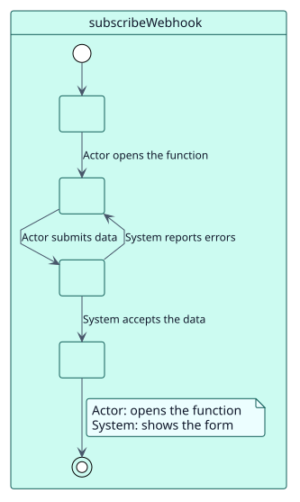

# UC-048 Subscribe a webhook

| Overview | Requirements | Analysis | Design | Implementation | Tests |
| --- | --- | --- | --- | --- | --- |
| [Use cases](../../../01-requirements/use-case-overview.svg) | **Requirements** | [Analysis](../../../02-analysis/use-cases/subscribeWebhook/README.md) | [Design](../../../03-design/use-cases/subscribeWebhook/README.md) | [Implementation](../../../04-implementation/use-cases/subscribeWebhook/README.md) | [Tests](../../../04-implementation/use-cases/subscribeWebhook/README.md#tests) |

## Use-case information

| Field | Value |
| --- | --- |
| Actor | Integrator owning an API client (with `api.webhooks.manage`) |
| Package | api |
| Goal | Have Kampus push the events an external system needs |
| Type | Primary, real |
| Level | User goal |
| Requirement | RF-104 |
| Domain entities | Webhook, Webhook delivery |

## Context

Webhooks are listeners of the event system with signed payloads, filtered by what the client may see.

## Preconditions

- The client exists and may see the chosen event types.

## Postconditions

- Success: events of those types are delivered to the URL, signed, at least once.
- Failure: nothing is subscribed.

## Main flow

| Step | Actor | System |
| --- | --- | --- |
| 1 | Gives a URL and event types | Checks HTTPS and that the address is not private (RN-201), and the types against the client's permissions (RN-199) |
| 2 | — | Delivers each event after commit with an HMAC signature, retrying with back-off (RN-200) |

## Alternative flows

| ID | Starts at step | Condition | Behaviour | Ends |
| --- | --- | --- | --- | --- |
| A1 | 2 | The endpoint keeps failing | The webhook is disabled and its owner notified (RN-200) | Failure |
| A2 | 1 | The URL resolves to a private address | `422` | Failure |

## Business rules

| ID | Rule |
| --- | --- |
| RN-199 | Filtered and signed |
| RN-200 | Deliveries with retries |
| RN-201 | No internal addresses |

## Specification

Behaviour source of truth: [specification.puml](./specification.puml)

## Wireframes

## Pending

| Question | Blocks |
| --- | --- |
| None | — |
