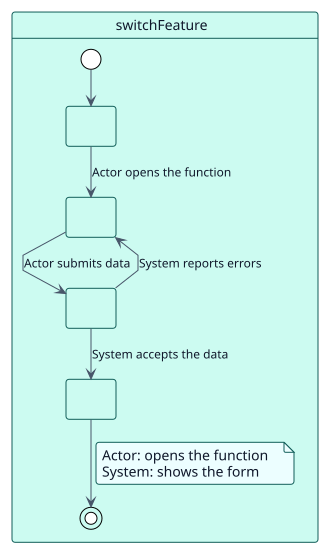

# UC-057 Switch a feature or module on or off

| Overview | Requirements | Analysis | Design | Implementation | Tests |
| --- | --- | --- | --- | --- | --- |
| [Use cases](../../../01-requirements/use-case-overview.svg) | **Requirements** | [Analysis](../../../02-analysis/use-cases/switchFeature/README.md) | [Design](../../../03-design/use-cases/switchFeature/README.md) | [Implementation](../../../04-implementation/use-cases/switchFeature/README.md) | [Tests](../../../04-implementation/use-cases/switchFeature/README.md#tests) |

## Use-case information

| Field | Value |
| --- | --- |
| Actor | Anyone holding `customise.flags.manage` in the scope |
| Package | customise |
| Goal | Roll a feature or a module out to a campus, tenant or course, or turn it off |
| Type | Primary, real |
| Level | User goal |
| Requirement | RF-118 |
| Domain entities | Feature flag |

## Context

Flags are declared by modules; a disabled feature hides its routes, UI modules and contributions and keeps its data.

## Preconditions

- The actor holds `customise.flags.manage` in the scope.

## Postconditions

- Success: the feature is on or off in the scope and below unless locked.
- Failure: no change.

## Main flow

| Step | Actor | System |
| --- | --- | --- |
| 1 | Opens the features of a scope | Shows each flag with its origin |
| 2 | Switches one | Stores the value and publishes `customise.changed`; contributions follow at once (RN-220) |

## Alternative flows

| ID | Starts at step | Condition | Behaviour | Ends |
| --- | --- | --- | --- | --- |
| A1 | 2 | Locked above | `409` | Failure |

## Business rules

| ID | Rule |
| --- | --- |
| RN-213 | Resolution and locks |
| RN-220 | Flags hide, never delete |

## Specification

Behaviour source of truth: [specification.puml](./specification.puml)

## Wireframes

## Pending

| Question | Blocks |
| --- | --- |
| None | — |
