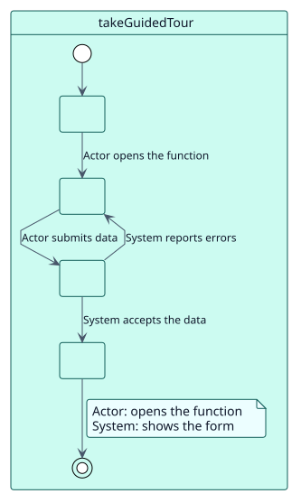
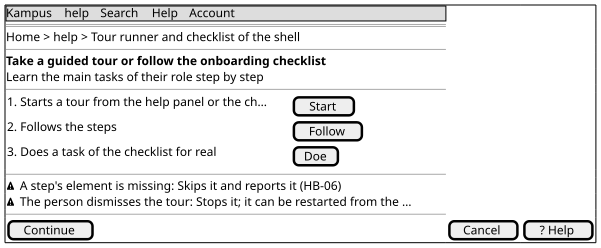

# UC-060 Take a guided tour or follow the onboarding checklist

| Overview | Requirements | Analysis | Design | Implementation | Tests |
| --- | --- | --- | --- | --- | --- |
| [Use cases](../../../01-requirements/use-case-overview.svg) | **Requirements** | [Analysis](../../../02-analysis/use-cases/takeGuidedTour/README.md) | [Design](../../../03-design/use-cases/takeGuidedTour/README.md) | [Implementation](../../../04-implementation/use-cases/takeGuidedTour/README.md) | [Tests](../../../04-implementation/use-cases/takeGuidedTour/README.md#tests) |

## Use-case information

| Field | Value |
| --- | --- |
| Actor | Any signed-in person; the checklist depends on their role |
| Package | help |
| Goal | Learn the main tasks of their role step by step |
| Type | Primary, real |
| Level | User goal |
| Requirement | RF-009 |
| Domain entities | Onboarding checklist, Guided tour, Preference |

## Context

Tours are data on stable element ids; checklist items tick themselves from the events of the real actions.

## Preconditions

- The person is signed in.

## Postconditions

- Success: the tour is completed or dismissed and the checklist progress is kept with the person's preferences.
- Failure: the tour stops; nothing else changes.

## Main flow

| Step | Actor | System |
| --- | --- | --- |
| 1 | Starts a tour from the help panel or the checklist | Loads the tour steps of the screen (HB-06) |
| 2 | Follows the steps | Highlights each element, accessible by keyboard and screen reader (HB-07) |
| 3 | Does a task of the checklist for real | Ticks the item from the action's event (HB-05) |

## Alternative flows

| ID | Starts at step | Condition | Behaviour | Ends |
| --- | --- | --- | --- | --- |
| A1 | 2 | A step's element is missing | Skips it and reports it (HB-06) | Success |
| A2 | 2 | The person dismisses the tour | Stops it; it can be restarted from the help panel (HB-07) | Success |

## Business rules

| ID | Rule |
| --- | --- |
| HB-05 | Onboarding checklists |
| HB-06 | Tours as data |
| HB-07 | Accessible, never blocking |

## Specification

Behaviour source of truth: [specification.puml](./specification.puml)

## Wireframes

## Pending

| Question | Blocks |
| --- | --- |
| None | — |
