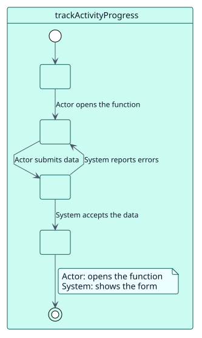

# UC-030 Track activity progress

| Overview | Requirements | Analysis | Design | Implementation | Tests |
| --- | --- | --- | --- | --- | --- |
| [Use cases](../../../01-requirements/use-case-overview.svg) | **Requirements** | [Analysis](../../../02-analysis/use-cases/trackActivityProgress/README.md) | [Design](../../../03-design/use-cases/trackActivityProgress/README.md) | [Implementation](../../../04-implementation/use-cases/trackActivityProgress/README.md) | [Tests](../../../04-implementation/use-cases/trackActivityProgress/README.md#tests) |

## Use-case information

| Field | Value |
| --- | --- |
| Actor | System (event listeners), and learners marking manual activities |
| Package | progress |
| Goal | Keep each person's state on each course module up to date |
| Type | Primary, real |
| Level | User goal |
| Requirement | RF-063 |
| Domain entities | Progress rule, Activity progress |

## Context

States are derived from events (views, submissions, grades, exceptions) and recorded with history; manual ticks belong to the learner.

## Preconditions

- The person is in the tracked population (RN-123).

## Postconditions

- Success: the state is updated when it changes, with history and an event.
- Failure: no change.

## Main flow

| Step | Actor | System |
| --- | --- | --- |
| 1 | A relevant event happens | The listener evaluates the course module's rules for that person (RN-116) |
| 2 | — | Stores the new state, history and `progress.activity_changed` |

## Alternative flows

| ID | Starts at step | Condition | Behaviour | Ends |
| --- | --- | --- | --- | --- |
| A1 | 1 | The learner marks a manual activity | Stores the state with source `manual` | Success |

## Business rules

| ID | Rule |
| --- | --- |
| RN-124 | Progress survives the participation |
| RN-115 | Enumerated states, displayed at read time |
| RN-116 | Re-evaluation by listeners |
| RN-123 | Tracked population |

## Specification

Behaviour source of truth: [specification.puml](./specification.puml)

## Wireframes

## Pending

| Question | Blocks |
| --- | --- |
| None | — |
