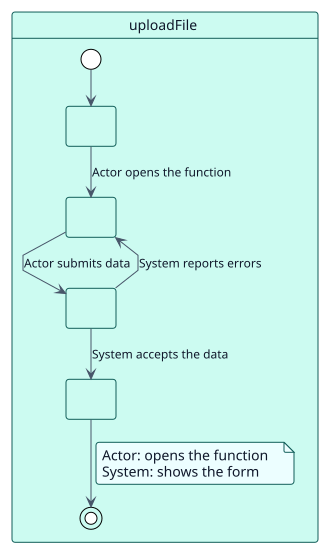

# UC-033 Upload a file

| Overview | Requirements | Analysis | Design | Implementation | Tests |
| --- | --- | --- | --- | --- | --- |
| [Use cases](../../../01-requirements/use-case-overview.svg) | **Requirements** | [Analysis](../../../02-analysis/use-cases/uploadFile/README.md) | [Design](../../../03-design/use-cases/uploadFile/README.md) | [Implementation](../../../04-implementation/use-cases/uploadFile/README.md) | [Tests](../../../04-implementation/use-cases/uploadFile/README.md#tests) |

## Use-case information

| Field | Value |
| --- | --- |
| Actor | Any signed-in person allowed to change the owner (a submission, a post, a course page) |
| Package | files |
| Goal | Attach a file to something they may change, within the limits of its area |
| Type | Primary, real |
| Level | User goal |
| Requirement | RF-080 |
| Domain entities | Upload session, Blob, File, Quota |

## Context

Every client (web, API, plugins) uses the same pipeline; the owning module attaches the file to its own entity.

## Preconditions

- The actor may change the owner; the area is declared by its module.

## Postconditions

- Success: the file exists, linked to its owner, the blob stored once and the quota updated; `files.file_attached` is published.
- Failure: nothing is stored; the session expires and is purged.

## Main flow

| Step | Actor | System |
| --- | --- | --- |
| 1 | Chooses a file for an area | Opens an upload session after checking size, type and quota (RN-129, RN-134) |
| 2 | Sends the content | Sniffs the type and computes the hash; reuses an existing blob (RN-126, RN-130) |
| 3 | Completes | Creates the file and the owner's link in one transaction; queues the scan (RN-127) |

## Alternative flows

| ID | Starts at step | Condition | Behaviour | Ends |
| --- | --- | --- | --- | --- |
| A1 | 1 | Over the quota or too large | `413` with the limit and the usage | Failure |
| A2 | 2 | The type is not allowed | `415`; the content is discarded | Failure |
| A3 | 3 | The scan finds malware | The file is quarantined and the owner told | Failure |

## Business rules

| ID | Rule |
| --- | --- |
| RN-133 | Unreferenced blobs to the trash |
| RN-136 | Moving between backends |
| RN-126 | One blob per hash |
| RN-127 | One owner |
| RN-129 | One pipeline |
| RN-130 | Sniffed type |
| RN-134 | Quotas |

## Specification

Behaviour source of truth: [specification.puml](./specification.puml)

## Wireframes

## Pending

| Question | Blocks |
| --- | --- |
| None | — |
