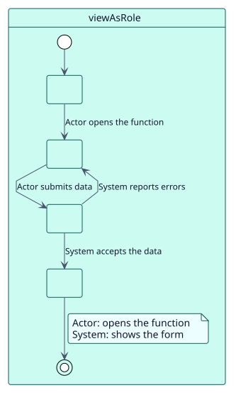

# UC-005 View a scope as another role

| Overview | Requirements | Analysis | Design | Implementation | Tests |
| --- | --- | --- | --- | --- | --- |
| [Use cases](../../../01-requirements/use-case-overview.svg) | **Requirements** | [Analysis](../../../02-analysis/use-cases/viewAsRole/README.md) | [Design](../../../03-design/use-cases/viewAsRole/README.md) | [Implementation](../../../04-implementation/use-cases/viewAsRole/README.md) | [Tests](../../../04-implementation/use-cases/viewAsRole/README.md#tests) |

## Use-case information

| Field | Value |
| --- | --- |
| Actor | Teacher, Manager, Section leader (with `access.view_as` in the scope and an allowance for the role) |
| Package | access |
| Goal | See a course, section or activity exactly as a learner, assistant or reviewer sees it |
| Type | Primary, real |
| Level | User goal |
| Requirement | RF-023 |
| Domain entities | View-as session, Role, Scope |

## Context

Teachers check what learners see before opening a section; managers check what a reviewer can reach. Viewing as never lets the person act as the other role.

## Preconditions

- The actor holds `access.view_as` in the scope and may view as the role (RN-018).

## Postconditions

- Success: a read-only session for the role in the scope and below; `access.view_as_started` is recorded in the audit log.
- Failure: no change.

## Main flow

| Step | Actor | System |
| --- | --- | --- |
| 1 | Chooses "view as" and a role in a scope | Checks RN-018 and starts the session |
| 2 | Browses | Every check uses only that role, read permissions only, inside the scope |
| 3 | Ends the session | Records `access.view_as_ended` |

## Alternative flows

| ID | Starts at step | Condition | Behaviour | Ends |
| --- | --- | --- | --- | --- |
| A1 | 2 | The person tries to change something | Refused: the session is read-only | Failure |
| A2 | 2 | The person leaves the scope | The session ends automatically | Success |

## Business rules

| ID | Rule |
| --- | --- |
| RN-018 | View as: read-only, limited to the scope, audited |
| RN-019 | Explanations show the role being viewed |

## Specification

Behaviour source of truth: [specification.puml](./specification.puml)

## Wireframes

## Pending

| Question | Blocks |
| --- | --- |
| None | — |
