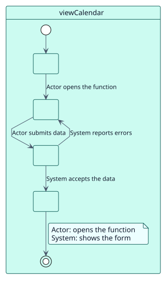

# UC-039 See the calendar

| Overview | Requirements | Analysis | Design | Implementation | Tests |
| --- | --- | --- | --- | --- | --- |
| [Use cases](../../../01-requirements/use-case-overview.svg) | **Requirements** | [Analysis](../../../02-analysis/use-cases/viewCalendar/README.md) | [Design](../../../03-design/use-cases/viewCalendar/README.md) | [Implementation](../../../04-implementation/use-cases/viewCalendar/README.md) | [Tests](../../../04-implementation/use-cases/viewCalendar/README.md#tests) |

## Use-case information

| Field | Value |
| --- | --- |
| Actor | Any signed-in person |
| Package | calendar |
| Goal | See campus, course, group, personal entries and activity dates in a period |
| Type | Primary, real |
| Level | User goal |
| Requirement | RF-072 |
| Domain entities | Calendar entry, Activity date, Recurrence |

## Context

The calendar reads the activity dates projection and applies the person's exceptions when read.

## Preconditions

- The person is signed in.

## Postconditions

- Success: the occurrences of the period visible to the person are shown in their time zone.
- Failure: nothing is shown.

## Main flow

| Step | Actor | System |
| --- | --- | --- |
| 1 | Opens a period | Collects entries of the scopes the person sees (RN-156) |
| 2 | — | Expands recurrences for the window (RN-158) and adds activity dates with exceptions (RN-157) |
| 3 | Adds a personal or course entry | Creates it in its scope, if allowed |

## Alternative flows

| ID | Starts at step | Condition | Behaviour | Ends |
| --- | --- | --- | --- | --- |
| A1 | 1 | An activity is hidden from the person | Its dates are not shown (RN-156) | Success |

## Business rules

| ID | Rule |
| --- | --- |
| RN-156 | Scope decides who sees |
| RN-157 | Activity dates as a projection |
| RN-158 | Recurrences on read |
| RN-160 | Time zones |

## Specification

Behaviour source of truth: [specification.puml](./specification.puml)

## Wireframes

## Pending

| Question | Blocks |
| --- | --- |
| None | — |
