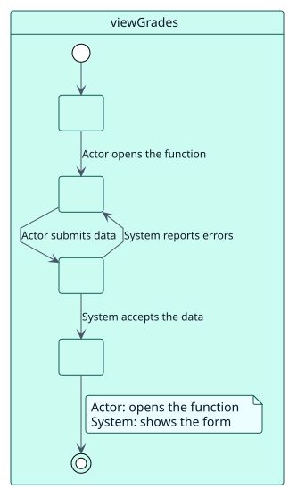

# UC-029 See grades

| Overview | Requirements | Analysis | Design | Implementation | Tests |
| --- | --- | --- | --- | --- | --- |
| [Use cases](../../../01-requirements/use-case-overview.svg) | **Requirements** | [Analysis](../../../02-analysis/use-cases/viewGrades/README.md) | [Design](../../../03-design/use-cases/viewGrades/README.md) | [Implementation](../../../04-implementation/use-cases/viewGrades/README.md) | [Tests](../../../04-implementation/use-cases/viewGrades/README.md#tests) |

## Use-case information

| Field | Value |
| --- | --- |
| Actor | Learner (own grades), teacher (grader report, exports) |
| Package | records |
| Goal | See grades and feedback exactly as permitted |
| Type | Primary, real |
| Level | User goal |
| Requirement | RF-062 |
| Domain entities | Grade, Grade record |

## Context

Every read, by people or by other modules, goes through one visibility service, so hidden grades never leak through totals.

## Preconditions

- The actor holds `records.view_own` or `records.view_all`.

## Postconditions

- Success: the grades the actor may see.
- Failure: none.

## Main flow

| Step | Actor | System |
| --- | --- | --- |
| 1 | Opens my grades or the grader report | Reads through the visibility service (RN-103), paginated on the server (RN-109) |
| 2 | Exports | A job builds the file with the same visibility |

## Alternative flows

| ID | Starts at step | Condition | Behaviour | Ends |
| --- | --- | --- | --- | --- |

## Business rules

| ID | Rule |
| --- | --- |
| RN-103 | One visibility service |
| RN-104 | Hidden until a date |
| RN-105 | Grades survive leaving a course |
| RN-109 | Server-side paging |

## Specification

Behaviour source of truth: [specification.puml](./specification.puml)

## Wireframes

## Pending

| Question | Blocks |
| --- | --- |
| None | — |
