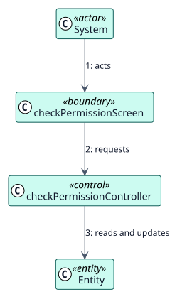

# UC-003 Check a permission, with its explanation — analysis realization

| Overview | Requirements | Analysis | Design | Implementation | Tests |
| --- | --- | --- | --- | --- | --- |
| [Use cases](../../../01-requirements/use-case-overview.svg) | [Requirements](../../../01-requirements/use-cases/checkPermission/README.md) | **Analysis** | [Design](../../../03-design/use-cases/checkPermission/README.md) | [Implementation](../../../04-implementation/use-cases/checkPermission/README.md) | [Tests](../../../04-implementation/use-cases/checkPermission/README.md#tests) |

Requirements: [README](../../../01-requirements/use-cases/checkPermission/README.md)

## Participating classes

| Class | Stereotype | Responsibility |
| --- | --- | --- |
| Every service operation, `POST /scopes/{id}/checks` | boundary | Ask for a decision |
| Permission checker | control | Apply RN-003 to RN-011, RN-019, RN-021 |
| Grant, values, scope closure | entity | Read state |

## Collaboration

## Notes

The checker is pure over loaded data, so it can be tested rule by rule and cached safely.
