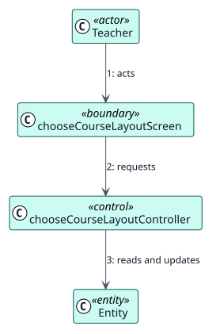

# UC-015 Choose a course layout — analysis realization

| Overview | Requirements | Analysis | Design | Implementation | Tests |
| --- | --- | --- | --- | --- | --- |
| [Use cases](../../../01-requirements/use-case-overview.svg) | [Requirements](../../../01-requirements/use-cases/chooseCourseLayout/README.md) | **Analysis** | [Design](../../../03-design/use-cases/chooseCourseLayout/README.md) | [Implementation](../../../04-implementation/use-cases/chooseCourseLayout/README.md) | [Tests](../../../04-implementation/use-cases/chooseCourseLayout/README.md#tests) |

Requirements: [README](../../../01-requirements/use-cases/chooseCourseLayout/README.md)

## Participating classes

| Class | Stereotype | Responsibility |
| --- | --- | --- |
| Course settings, `/courses/{id}/layout` | boundary | Choose and configure |
| Layout registry and course service | control | Apply RN-052 |
| Course, Course layout setting | entity | Persisted state |

## Collaboration

## Notes

Layouts are UI modules plus a settings schema; they never own course data.
