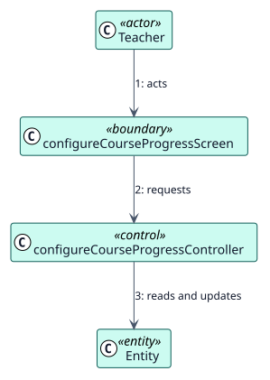

# UC-031 Configure course progress — analysis realization

| Overview | Requirements | Analysis | Design | Implementation | Tests |
| --- | --- | --- | --- | --- | --- |
| [Use cases](../../../01-requirements/use-case-overview.svg) | [Requirements](../../../01-requirements/use-cases/configureCourseProgress/README.md) | **Analysis** | [Design](../../../03-design/use-cases/configureCourseProgress/README.md) | [Implementation](../../../04-implementation/use-cases/configureCourseProgress/README.md) | [Tests](../../../04-implementation/use-cases/configureCourseProgress/README.md#tests) |

Requirements: [README](../../../01-requirements/use-cases/configureCourseProgress/README.md)

## Participating classes

| Class | Stereotype | Responsibility |
| --- | --- | --- |
| Course progress settings, `/courses/{id}/progress-criteria`, `/prerequisites` | boundary | Collect the request |
| Course progress service | control | Apply RN-120 to RN-122 |
| Course criterion, Prerequisite, Course progress | entity | Persisted state |

## Collaboration

## Notes

Every change is one transaction with its events in the outbox (DEC-016).
