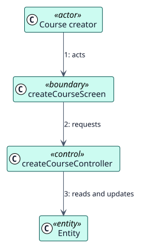

# UC-012 Create and configure a course — analysis realization

| Overview | Requirements | Analysis | Design | Implementation | Tests |
| --- | --- | --- | --- | --- | --- |
| [Use cases](../../../01-requirements/use-case-overview.svg) | [Requirements](../../../01-requirements/use-cases/createCourse/README.md) | **Analysis** | [Design](../../../03-design/use-cases/createCourse/README.md) | [Implementation](../../../04-implementation/use-cases/createCourse/README.md) | [Tests](../../../04-implementation/use-cases/createCourse/README.md#tests) |

Requirements: [README](../../../01-requirements/use-cases/createCourse/README.md)

## Participating classes

| Class | Stereotype | Responsibility |
| --- | --- | --- |
| Course creation and settings, `/categories/{id}/courses`, `/courses/{id}` | boundary | Collect data |
| Course service | control | Apply RN-041, RN-042, RN-049 to RN-051 |
| Course, Course owner, Section | entity | Persisted state |

## Collaboration

## Notes

Creation is one transaction across the course, its scope, sections and grants; the grants go through the access service.
