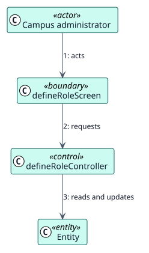

# UC-004 Define a role from a template — analysis realization

| Overview | Requirements | Analysis | Design | Implementation | Tests |
| --- | --- | --- | --- | --- | --- |
| [Use cases](../../../01-requirements/use-case-overview.svg) | [Requirements](../../../01-requirements/use-cases/defineRole/README.md) | **Analysis** | [Design](../../../03-design/use-cases/defineRole/README.md) | [Implementation](../../../04-implementation/use-cases/defineRole/README.md) | [Tests](../../../04-implementation/use-cases/defineRole/README.md#tests) |

Requirements: [README](../../../01-requirements/use-cases/defineRole/README.md)

## Participating classes

| Class | Stereotype | Responsibility |
| --- | --- | --- |
| Roles screens, `/campuses/{id}/roles`, `/roles/{id}` | boundary | Edit and preview |
| Role service | control | Apply RN-008, RN-015, RN-017 |
| Role, Role template, values, allowances | entity | Persisted state |

## Collaboration

## Notes

Template versions are data shipped with each release; a campus never changes silently when Kampus is upgraded.
