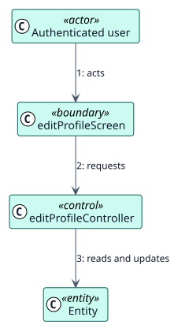

# UC-010 Edit a profile — analysis realization

| Overview | Requirements | Analysis | Design | Implementation | Tests |
| --- | --- | --- | --- | --- | --- |
| [Use cases](../../../01-requirements/use-case-overview.svg) | [Requirements](../../../01-requirements/use-cases/editProfile/README.md) | **Analysis** | [Design](../../../03-design/use-cases/editProfile/README.md) | [Implementation](../../../04-implementation/use-cases/editProfile/README.md) | [Tests](../../../04-implementation/use-cases/editProfile/README.md#tests) |

Requirements: [README](../../../01-requirements/use-cases/editProfile/README.md)

## Participating classes

| Class | Stereotype | Responsibility |
| --- | --- | --- |
| Profile page, `/me/profile`, `/accounts/{id}/profile` | boundary | Show and edit |
| Profile service | control | Apply RN-036 |
| Profile, Custom field value | entity | Persisted state |

## Collaboration

## Notes

Visibility is applied in the query, so hidden fields never reach the client.
