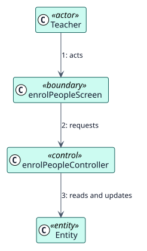

# UC-016 Enrol people in a course — analysis realization

| Overview | Requirements | Analysis | Design | Implementation | Tests |
| --- | --- | --- | --- | --- | --- |
| [Use cases](../../../01-requirements/use-case-overview.svg) | [Requirements](../../../01-requirements/use-cases/enrolPeople/README.md) | **Analysis** | [Design](../../../03-design/use-cases/enrolPeople/README.md) | [Implementation](../../../04-implementation/use-cases/enrolPeople/README.md) | [Tests](../../../04-implementation/use-cases/enrolPeople/README.md#tests) |

Requirements: [README](../../../01-requirements/use-cases/enrolPeople/README.md)

## Participating classes

| Class | Stereotype | Responsibility |
| --- | --- | --- |
| Participants page, `/enrolment-instances/{id}/enrolments` | boundary | Collect people, role and period |
| Enrolment service | control | Apply RN-061 to RN-063, RN-073 |
| Enrolment, Enrolment grant | entity | Persisted state |

## Collaboration

## Notes

The grant is created through the access service inside the same transaction.
