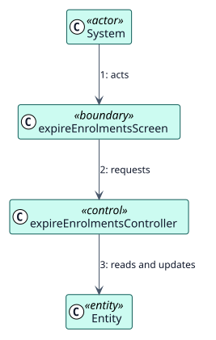

# UC-020 Expire enrolments — analysis realization

| Overview | Requirements | Analysis | Design | Implementation | Tests |
| --- | --- | --- | --- | --- | --- |
| [Use cases](../../../01-requirements/use-case-overview.svg) | [Requirements](../../../01-requirements/use-cases/expireEnrolments/README.md) | **Analysis** | [Design](../../../03-design/use-cases/expireEnrolments/README.md) | [Implementation](../../../04-implementation/use-cases/expireEnrolments/README.md) | [Tests](../../../04-implementation/use-cases/expireEnrolments/README.md#tests) |

Requirements: [README](../../../01-requirements/use-cases/expireEnrolments/README.md)

## Participating classes

| Class | Stereotype | Responsibility |
| --- | --- | --- |
| Scheduler | boundary | Start the job |
| Expiry job | control | Apply RN-068 |
| Enrolment, Expiry outcome | entity | Persisted state |

## Collaboration

## Notes

Batches and locks let several workers run the job without double processing.
