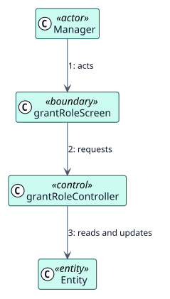

# UC-001 Grant a role in a scope — analysis realization

| Overview | Requirements | Analysis | Design | Implementation | Tests |
| --- | --- | --- | --- | --- | --- |
| [Use cases](../../../01-requirements/use-case-overview.svg) | [Requirements](../../../01-requirements/use-cases/grantRole/README.md) | **Analysis** | [Design](../../../03-design/use-cases/grantRole/README.md) | [Implementation](../../../04-implementation/use-cases/grantRole/README.md) | [Tests](../../../04-implementation/use-cases/grantRole/README.md#tests) |

Requirements: [README](../../../01-requirements/use-cases/grantRole/README.md)

## Participating classes

| Class | Stereotype | Responsibility |
| --- | --- | --- |
| People screen of a scope, `POST /scopes/{id}/grants` | boundary | Collect the request and the idempotency key |
| Grant service | control | Apply RN-013, RN-015, RN-016 |
| Grant, Role, Scope, Role allowance | entity | Persisted state |

## Collaboration

## Notes

Granting to many people is one operation with one transaction; partial success is reported per person.
