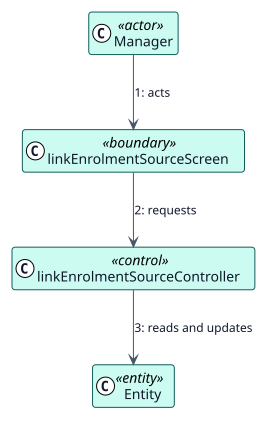

# UC-019 Link a system group or a course — analysis realization

| Overview | Requirements | Analysis | Design | Implementation | Tests |
| --- | --- | --- | --- | --- | --- |
| [Use cases](../../../01-requirements/use-case-overview.svg) | [Requirements](../../../01-requirements/use-cases/linkEnrolmentSource/README.md) | **Analysis** | [Design](../../../03-design/use-cases/linkEnrolmentSource/README.md) | [Implementation](../../../04-implementation/use-cases/linkEnrolmentSource/README.md) | [Tests](../../../04-implementation/use-cases/linkEnrolmentSource/README.md#tests) |

Requirements: [README](../../../01-requirements/use-cases/linkEnrolmentSource/README.md)

## Participating classes

| Class | Stereotype | Responsibility |
| --- | --- | --- |
| Enrolment methods page, `/enrolment-instances/{id}/source` | boundary | Choose the source |
| Sync service and job | control | Apply RN-067 |
| Linked source, Enrolment | entity | Persisted state |

## Collaboration

## Notes

The sync is idempotent: running it twice changes nothing the second time.
