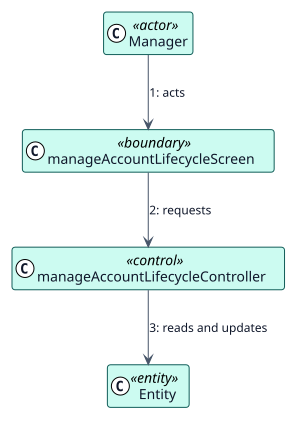

# UC-009 Manage the lifecycle of accounts — analysis realization

| Overview | Requirements | Analysis | Design | Implementation | Tests |
| --- | --- | --- | --- | --- | --- |
| [Use cases](../../../01-requirements/use-case-overview.svg) | [Requirements](../../../01-requirements/use-cases/manageAccountLifecycle/README.md) | **Analysis** | [Design](../../../03-design/use-cases/manageAccountLifecycle/README.md) | [Implementation](../../../04-implementation/use-cases/manageAccountLifecycle/README.md) | [Tests](../../../04-implementation/use-cases/manageAccountLifecycle/README.md#tests) |

Requirements: [README](../../../01-requirements/use-cases/manageAccountLifecycle/README.md)

## Participating classes

| Class | Stereotype | Responsibility |
| --- | --- | --- |
| People administration, `/campuses/{id}/accounts`, `/accounts/{id}/transitions` | boundary | Collect transitions |
| Account lifecycle service | control | Apply RN-023, RN-031, RN-034, RN-035, RN-038 |
| Account, Account transition | entity | Persisted state |

## Collaboration

## Notes

Deletion is a job that calls the privacy handler of every module declared through the module contract.
