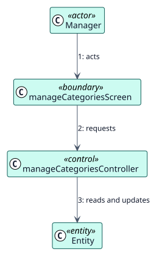

# UC-011 Manage course categories — analysis realization

| Overview | Requirements | Analysis | Design | Implementation | Tests |
| --- | --- | --- | --- | --- | --- |
| [Use cases](../../../01-requirements/use-case-overview.svg) | [Requirements](../../../01-requirements/use-cases/manageCategories/README.md) | **Analysis** | [Design](../../../03-design/use-cases/manageCategories/README.md) | [Implementation](../../../04-implementation/use-cases/manageCategories/README.md) | [Tests](../../../04-implementation/use-cases/manageCategories/README.md#tests) |

Requirements: [README](../../../01-requirements/use-cases/manageCategories/README.md)

## Participating classes

| Class | Stereotype | Responsibility |
| --- | --- | --- |
| Catalogue administration, `/campuses/{id}/categories`, `/categories/{id}` | boundary | Collect changes |
| Category service | control | Apply RN-040, RN-041, RN-043, RN-046 |
| Course category, Scope | entity | Persisted state |

## Collaboration

## Notes

Reordering writes one row; a rebalancing job rewrites the keys of one parent only when they get too long.
