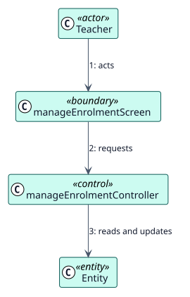

# UC-018 Manage an enrolment — analysis realization

| Overview | Requirements | Analysis | Design | Implementation | Tests |
| --- | --- | --- | --- | --- | --- |
| [Use cases](../../../01-requirements/use-case-overview.svg) | [Requirements](../../../01-requirements/use-cases/manageEnrolment/README.md) | **Analysis** | [Design](../../../03-design/use-cases/manageEnrolment/README.md) | [Implementation](../../../04-implementation/use-cases/manageEnrolment/README.md) | [Tests](../../../04-implementation/use-cases/manageEnrolment/README.md#tests) |

Requirements: [README](../../../01-requirements/use-cases/manageEnrolment/README.md)

## Participating classes

| Class | Stereotype | Responsibility |
| --- | --- | --- |
| Participants page, `/enrolments/{id}` | boundary | Collect changes |
| Enrolment service | control | Apply RN-060, RN-061, RN-069, RN-070 |
| Enrolment, Enrolment grant | entity | Persisted state |

## Collaboration

## Notes

Records and progress listen to enrolment events only to hide or show, never to delete.
