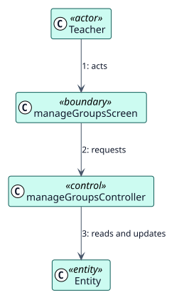

# UC-014 Manage groups and group sets — analysis realization

| Overview | Requirements | Analysis | Design | Implementation | Tests |
| --- | --- | --- | --- | --- | --- |
| [Use cases](../../../01-requirements/use-case-overview.svg) | [Requirements](../../../01-requirements/use-cases/manageGroups/README.md) | **Analysis** | [Design](../../../03-design/use-cases/manageGroups/README.md) | [Implementation](../../../04-implementation/use-cases/manageGroups/README.md) | [Tests](../../../04-implementation/use-cases/manageGroups/README.md#tests) |

Requirements: [README](../../../01-requirements/use-cases/manageGroups/README.md)

## Participating classes

| Class | Stereotype | Responsibility |
| --- | --- | --- |
| Groups screens, `/courses/{id}/groups`, `/groups/{id}` | boundary | Collect changes |
| Group service | control | Apply RN-041, RN-053 to RN-058 |
| Group, Group membership, Group set | entity | Persisted state |

## Collaboration

## Notes

Separate-group filtering is applied in the queries of every module through the access and courses services.
