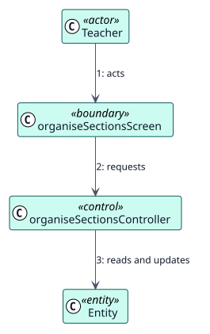

# UC-013 Organise the sections of a course — analysis realization

| Overview | Requirements | Analysis | Design | Implementation | Tests |
| --- | --- | --- | --- | --- | --- |
| [Use cases](../../../01-requirements/use-case-overview.svg) | [Requirements](../../../01-requirements/use-cases/organiseSections/README.md) | **Analysis** | [Design](../../../03-design/use-cases/organiseSections/README.md) | [Implementation](../../../04-implementation/use-cases/organiseSections/README.md) | [Tests](../../../04-implementation/use-cases/organiseSections/README.md#tests) |

Requirements: [README](../../../01-requirements/use-cases/organiseSections/README.md)

## Participating classes

| Class | Stereotype | Responsibility |
| --- | --- | --- |
| Course editor, `/courses/{id}/sections`, `/sections/{id}` | boundary | Collect changes |
| Section service | control | Apply RN-043, RN-045, RN-047, RN-048 |
| Section, Scope | entity | Persisted state |

## Collaboration

## Notes

Nothing references a section by position, so a move never touches other rows.
