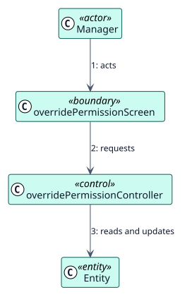

# UC-002 Override permissions in a scope — analysis realization

| Overview | Requirements | Analysis | Design | Implementation | Tests |
| --- | --- | --- | --- | --- | --- |
| [Use cases](../../../01-requirements/use-case-overview.svg) | [Requirements](../../../01-requirements/use-cases/overridePermission/README.md) | **Analysis** | [Design](../../../03-design/use-cases/overridePermission/README.md) | [Implementation](../../../04-implementation/use-cases/overridePermission/README.md) | [Tests](../../../04-implementation/use-cases/overridePermission/README.md#tests) |

Requirements: [README](../../../01-requirements/use-cases/overridePermission/README.md)

## Participating classes

| Class | Stereotype | Responsibility |
| --- | --- | --- |
| Permissions screen, `PUT /scopes/{id}/overrides` | boundary | Send the changes with the version |
| Override service | control | Apply RN-008, RN-012, RN-014, RN-015 |
| Permission override | entity | Persisted state |

## Collaboration

## Notes

The screen shows effective values with their origin, so people see the result before they save.
