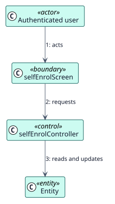

# UC-017 Enrol oneself in a course — analysis realization

| Overview | Requirements | Analysis | Design | Implementation | Tests |
| --- | --- | --- | --- | --- | --- |
| [Use cases](../../../01-requirements/use-case-overview.svg) | [Requirements](../../../01-requirements/use-cases/selfEnrol/README.md) | **Analysis** | [Design](../../../03-design/use-cases/selfEnrol/README.md) | [Implementation](../../../04-implementation/use-cases/selfEnrol/README.md) | [Tests](../../../04-implementation/use-cases/selfEnrol/README.md#tests) |

Requirements: [README](../../../01-requirements/use-cases/selfEnrol/README.md)

## Participating classes

| Class | Stereotype | Responsibility |
| --- | --- | --- |
| Course page, `/enrolment-instances/{id}/self` | boundary | Join |
| Self-enrolment service | control | Apply RN-063 to RN-066 |
| Enrolment, Request, Key | entity | Persisted state |

## Collaboration

## Notes

Concurrent joins serialise on the instance lock, so the capacity is never exceeded.
